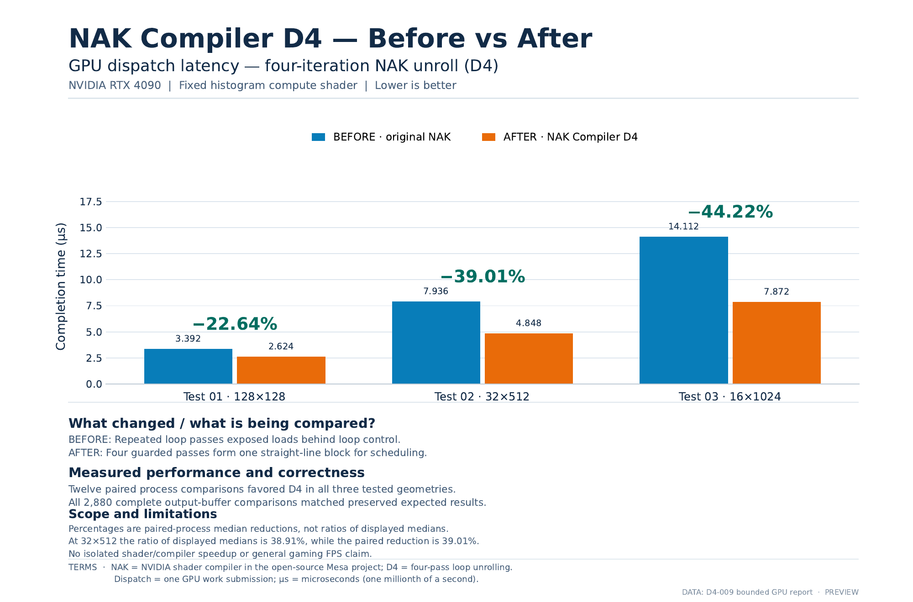
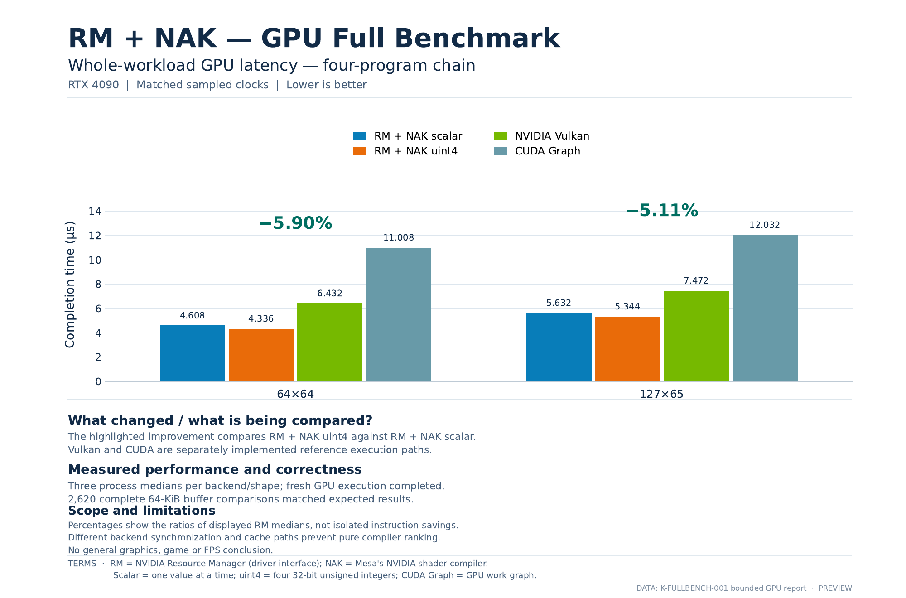

# NVIDIA — Benchmark Results

**Recorded test hardware:** GeForce RTX 4090 (Ada Lovelace), with separate community submissions linked below.

The historical results in this section are bounded GPU compute experiments. They are not game benchmarks, complete Direct3D 12 qualification or a general ranking of graphics APIs. The published tables preserve measurement values and correctness scope; additional internal implementation notes are not part of this overview.

## Histogram experiment

The GPU counted occurrences of values 0–255 in a generated 16,384-element input. The two code revisions were measured on the same recorded hardware. The table reports the historical experiment's paired-process median reductions.

| Input arrangement (not a display resolution) | Original | Updated | Recorded time reduction |
| --- | ---: | ---: | ---: |
| 128×128 | 3,392 ns | 2,624 ns | 22.64% |
| 32×512 | 7,936 ns | 4,848 ns | 39.01% |
| 16×1024 | 14,112 ns | 7,872 ns | 44.22% |

The campaign reported **2,880 complete output-buffer comparisons** with expected results. The figures measure the GPU dispatch interval of this workload, not an isolated compiler pass.

## Four-program compute chain

The second experiment used four dependent GPU programs to process generated 32-bit input values. Timing covers the **complete GPU chain**, including required coordination between its programs.

| Input arrangement | Original | Updated | Recorded whole-chain time reduction |
| --- | ---: | ---: | ---: |
| 64×64 (4,096 values) | 4,608 ns | 4,336 ns | 5.90% |
| 127×65 (8,255 values) | 5,632 ns | 5,344 ns | 5.11% |

The campaign reported **2,620 complete output-buffer comparisons** against expected data. Independently timed Vulkan and CUDA implementations appear only as reference observations; differences in timing boundaries, resource placement and synchronization prevent a general cross-backend ranking.

## Other recorded checks

| Test | Recorded status |
| --- | --- |
| Affine u32 | GPU execution completed; the complete numerical output was compared against expected values |
| FidelityFX ParallelSort N515 | GPU execution completed; final sorting and permutation checks passed |

The latter checks did not constitute a qualified performance comparison.

## Submitted results

- [NVIDIA GeForce RTX 3060](RTX_3060/)
- [NVIDIA GeForce RTX 3060 Ti](RTX_3060_Ti/)
- [NVIDIA GeForce RTX 3080 12GB](RTX_3080_12GB/)
- [NVIDIA GeForce RTX 3090](RTX_3090/)
- [NVIDIA GeForce RTX 4060](RTX_4060/)
- [NVIDIA GeForce RTX 4060 Laptop GPU](RTX_4060_Laptop_GPU/)
- [NVIDIA GeForce RTX 4090](RTX_4090/)

## Reproducibility and limits

The public source release does not currently offer a ready-to-run reproduction of these exact historical experiments. Private development evidence is retained. Hardware, timings and evidence scope are summarized in [measurement details](measurement-details.md); see also [CPU build and validation](../../docs/validation.md).

[All benchmark results](../README.md) · [Project home](../../README.md)
