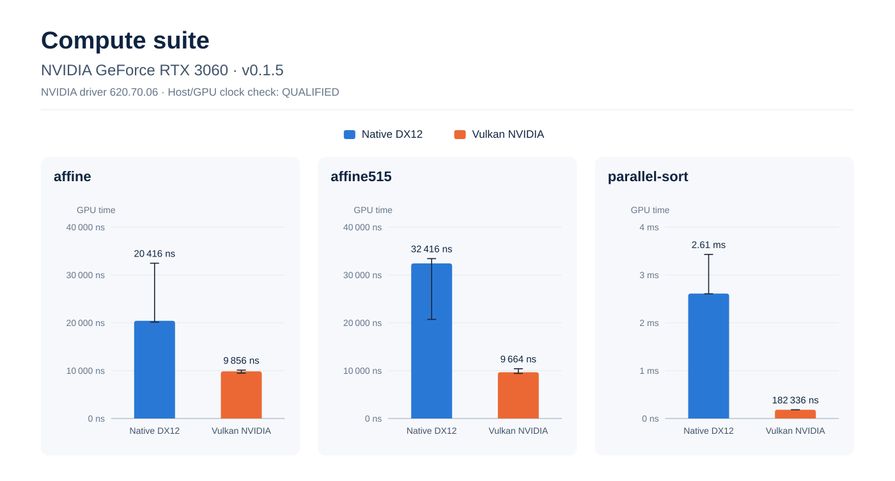
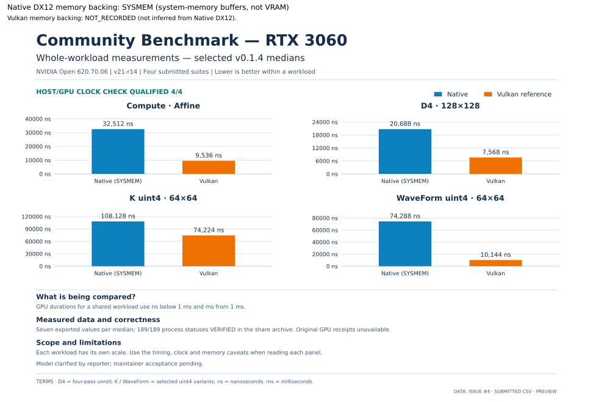

# NVIDIA GeForce RTX 3060 — community results

Community benchmark submissions for the NVIDIA GeForce RTX 3060, newest release first. Each section shows the reported medians and chart of one submission, with its checks and limits.

<!-- ndx12:results:NVIDIA/RTX_3060/v0.1.5:start -->
## Benchmark v0.1.5 results

### [Issue #10](https://github.com/GoblinFlash/Native-DX12-Linux/issues/10)

GPU PCI ID: `10de:2503` · Driver: `620.70.06` · Export: **189/189 VERIFIED** · Host/GPU clock check: **QUALIFIED, 4/4 suites**.

**Native DX12 memory backing: SYSMEM (system-memory buffers, not VRAM)**. [Release evidence](https://github.com/GoblinFlash/Native-DX12-Linux/blob/v0.1.5/NDX12_GPU_Benchmark/README.md#L113).

*Selected medians from the four suites; all variants appear in the tables below.*

#### Compute suite

| Workload / native variant | Native SYSMEM median GPU time | Vulkan median GPU time (backing: NOT_RECORDED) |
| --- | ---: | ---: |
| Affine | 20,416 ns | 9,856 ns |
| Affine N515 | 32,416 ns | 9,664 ns |
| ParallelSort N515 | 2.61 ms | 182,336 ns |

#### Test 1 — D4

| Workload / native variant | Native SYSMEM median GPU time | Vulkan median GPU time (backing: NOT_RECORDED) |
| --- | ---: | ---: |
| 128×128 Original | 27,568 ns | 7,680 ns |
| 128×128 D4 | 20,688 ns | 7,680 ns |
| 32×512 Original | 67,408 ns | 10,976 ns |
| 32×512 D4 | 40,208 ns | 10,976 ns |
| 16×1024 Original | 121,104 ns | 15,840 ns |
| 16×1024 D4 | 66,544 ns | 15,840 ns |

#### Test 2 — K

| Workload / native variant | Native SYSMEM median GPU time | Vulkan median GPU time (backing: NOT_RECORDED) |
| --- | ---: | ---: |
| 64×64 scalar | 117,584 ns | 74,208 ns |
| 64×64 uint4 | 108,160 ns | 74,208 ns |
| 127×65 scalar | 240,496 ns | 143,552 ns |
| 127×65 uint4 | 211,920 ns | 143,552 ns |

#### Test 3 — K WaveForm

| Workload / native variant | Native SYSMEM median GPU time | Vulkan median GPU time (backing: NOT_RECORDED) |
| --- | ---: | ---: |
| 64×64 scalar | 77,008 ns | 10,208 ns |
| 64×64 uint4 | 74,352 ns | 10,208 ns |
| 127×65 scalar | 113,264 ns | 10,496 ns |
| 127×65 uint4 | 110,160 ns | 10,496 ns |

[Full sanitized per-Issue data](v0.1.5/issue-10/README.md) · [All v0.1.5 submissions](../../v0.1.5-submitted-data.md#rtx-3060--issue-10)

Exported statuses and clock checks are reported evidence, not independent GPU qualification.
<!-- ndx12:results:NVIDIA/RTX_3060/v0.1.5:end -->

## Benchmark v0.1.4 results

**Existing v0.1.4 results — Native DX12 memory backing: SYSMEM (system-memory buffers, not VRAM).** This is the documented backing of the release artifact, not independent observation of the submitted host. Vulkan memory backing: **NOT_RECORDED**; do not infer it from Native DX12. [Release evidence](https://github.com/GoblinFlash/Native-DX12-Linux/blob/v0.1.4/NDX12_GPU_Benchmark/README.md#L111). The experimental VRAM candidate is separate.

**Review status: reporter clarification received; final maintainer acceptance pending.**

[Issue #4](https://github.com/GoblinFlash/Native-DX12-Linux/issues/4) was originally submitted as RTX 3060 Ti, but the v0.1.4 archive identifies **NVIDIA GeForce RTX 3060 (PCI `10de:2503`)**. The reporter subsequently checked the physical card and confirmed that it is the regular RTX 3060.

The attached export reports **189/189 VERIFIED** process statuses, including 119 native and 70 Vulkan reference processes. All four host/GPU clock checks are reported QUALIFIED. These are exported statuses, not independently repeated GPU execution.

One exported row has `kernel_records=1` (compute / affine515 / native / repeat 4). The reporter identified it as an `hrtimer` interrupt-latency message, unrelated to GPU faults, and reported no Xid/ECC/NVRM errors. The original kernel log line is not included in the shared archive; the explanation is **reporter-provided**, not independently verified.

**[Read the extracted v0.1.4 measurements](../../v0.1.4-submitted-data.md#rtx-3060--issue-4)**. Publishing these submitted values does not mean the run has been accepted as an independently qualified performance baseline.

### [Issue #4](https://github.com/GoblinFlash/Native-DX12-Linux/issues/4)

GPU PCI ID: `10de:2503` · Driver: `620.70.06` · Export: **189/189 VERIFIED** · Clock model: **QUALIFIED in all suites**.

The reporter confirmed that the card is a regular RTX 3060, not a Ti. The single `kernel_records=1` entry was described by the reporter as an unrelated `hrtimer` latency message. Its raw original kernel line is not in the share archive.

*Selected medians from the four suites; all recorded variants appear in the tables below.*

#### Compute suite

| Workload / native variant | Native SYSMEM median GPU time | Vulkan median GPU time |
| --- | ---: | ---: |
| Affine | 32,512 ns | 9,536 ns |
| Affine N515 | 22,752 ns | 9,568 ns |
| ParallelSort N515 | 2.61 ms | 181,856 ns |

#### Test 1 — D4

| Workload / native variant | Native SYSMEM median GPU time | Vulkan median GPU time |
| --- | ---: | ---: |
| 128×128 Original | 27,504 ns | 7,568 ns |
| 128×128 D4 | 20,688 ns | 7,568 ns |
| 32×512 Original | 67,376 ns | 11,008 ns |
| 32×512 D4 | 40,192 ns | 11,008 ns |
| 16×1024 Original | 121,104 ns | 15,760 ns |
| 16×1024 D4 | 66,512 ns | 15,760 ns |

#### Test 2 — K

| Workload / native variant | Native SYSMEM median GPU time | Vulkan median GPU time |
| --- | ---: | ---: |
| 64×64 scalar | 117,744 ns | 74,224 ns |
| 64×64 uint4 | 108,128 ns | 74,224 ns |
| 127×65 scalar | 239,328 ns | 144,240 ns |
| 127×65 uint4 | 215,072 ns | 144,240 ns |

#### Test 3 — K WaveForm

| Workload / native variant | Native SYSMEM median GPU time | Vulkan median GPU time |
| --- | ---: | ---: |
| 64×64 scalar | 76,928 ns | 10,144 ns |
| 64×64 uint4 | 74,288 ns | 10,144 ns |
| 127×65 scalar | 113,264 ns | 10,512 ns |
| 127×65 uint4 | 110,112 ns | 10,512 ns |

Submitted archive SHA-256: `96d095c11364e83cf196144c9aac341c1a7a0be43355ef90820b9a9a8ff29345`.

[All community GPU results](../../README.md)
