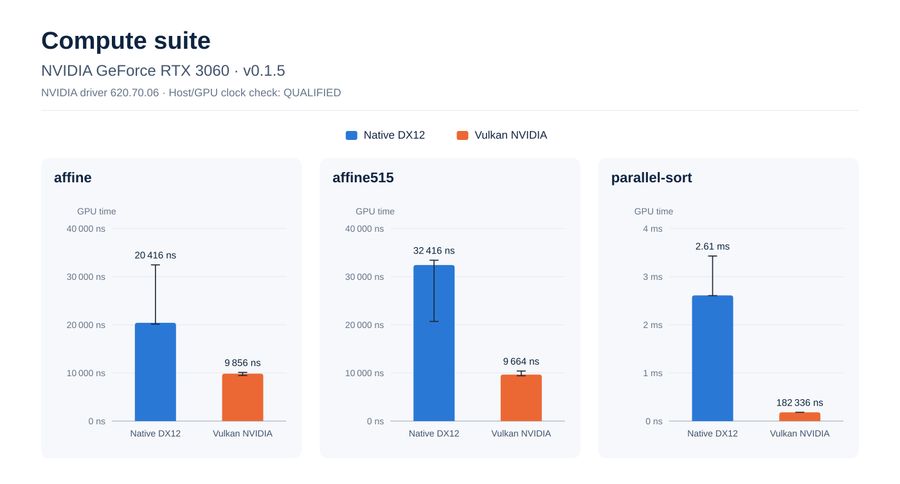

<!-- ndx12:gpu:NVIDIA/RTX_3060/v0.1.5:start -->
# RTX 3060 — benchmark v0.1.5

## [Issue #10](https://github.com/GoblinFlash/Native-DX12-Linux/issues/10)

GPU PCI ID: `10de:2503` · Driver: `620.70.06` · Export: **189/189 VERIFIED** · Host/GPU clock check: **QUALIFIED, 4/4 suites**.

**Native DX12 memory backing: SYSMEM (system-memory buffers, not VRAM)**. [Release evidence](https://github.com/GoblinFlash/Native-DX12-Linux/blob/v0.1.5/NDX12_GPU_Benchmark/README.md#L113).

*Selected medians from the four suites; all variants appear in the tables below.*

### Compute suite

| Workload / native variant | Native SYSMEM median GPU time | Vulkan median GPU time (backing: NOT_RECORDED) |
| --- | ---: | ---: |
| Affine | 20,416 ns | 9,856 ns |
| Affine N515 | 32,416 ns | 9,664 ns |
| ParallelSort N515 | 2.61 ms | 182,336 ns |

### Test 1 — D4

| Workload / native variant | Native SYSMEM median GPU time | Vulkan median GPU time (backing: NOT_RECORDED) |
| --- | ---: | ---: |
| 128×128 Original | 27,568 ns | 7,680 ns |
| 128×128 D4 | 20,688 ns | 7,680 ns |
| 32×512 Original | 67,408 ns | 10,976 ns |
| 32×512 D4 | 40,208 ns | 10,976 ns |
| 16×1024 Original | 121,104 ns | 15,840 ns |
| 16×1024 D4 | 66,544 ns | 15,840 ns |

### Test 2 — K

| Workload / native variant | Native SYSMEM median GPU time | Vulkan median GPU time (backing: NOT_RECORDED) |
| --- | ---: | ---: |
| 64×64 scalar | 117,584 ns | 74,208 ns |
| 64×64 uint4 | 108,160 ns | 74,208 ns |
| 127×65 scalar | 240,496 ns | 143,552 ns |
| 127×65 uint4 | 211,920 ns | 143,552 ns |

### Test 3 — K WaveForm

| Workload / native variant | Native SYSMEM median GPU time | Vulkan median GPU time (backing: NOT_RECORDED) |
| --- | ---: | ---: |
| 64×64 scalar | 77,008 ns | 10,208 ns |
| 64×64 uint4 | 74,352 ns | 10,208 ns |
| 127×65 scalar | 113,264 ns | 10,496 ns |
| 127×65 uint4 | 110,160 ns | 10,496 ns |

[Full sanitized per-Issue data](issue-10/README.md) · [All v0.1.5 submissions](../../../v0.1.5-submitted-data.md#rtx-3060--issue-10)

Exported statuses and clock checks are reported evidence, not independent GPU qualification.
<!-- ndx12:gpu:NVIDIA/RTX_3060/v0.1.5:end -->
