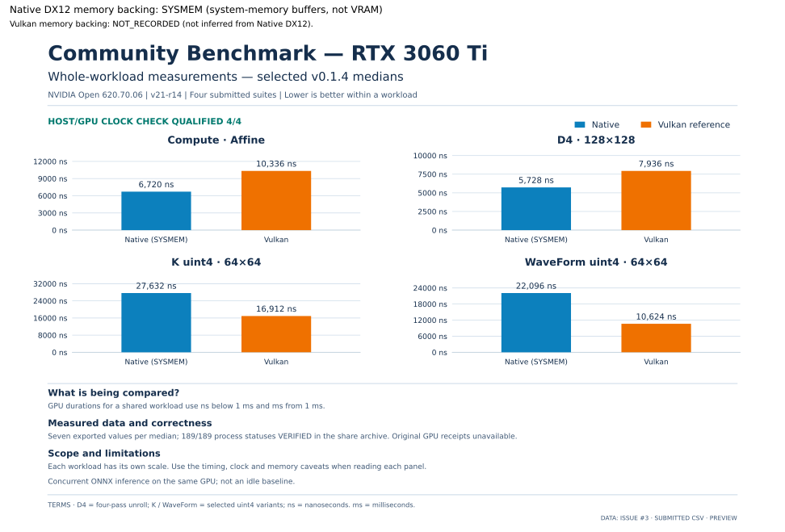

# NVIDIA GeForce RTX 3060 Ti — community results

Community benchmark submissions for the NVIDIA GeForce RTX 3060 Ti, newest release first. Each section shows the reported medians and chart of one submission, with its checks and limits.

## Benchmark v0.1.4 results

**Existing v0.1.4 results — Native DX12 memory backing: SYSMEM (system-memory buffers, not VRAM).** This is the documented backing of the release artifact, not independent observation of the submitted host. Vulkan memory backing: **NOT_RECORDED**; do not infer it from Native DX12. [Release evidence](https://github.com/GoblinFlash/Native-DX12-Linux/blob/v0.1.4/NDX12_GPU_Benchmark/README.md#L111). The experimental VRAM candidate is separate.

**Archive-consistency checked** submission:

- [Issue #3 — v0.1.4 benchmark](issue-3.md), reported on a desktop RTX 3060 Ti (PCI `10de:2489`).

The exported `run.json`, summary and CSV files are internally consistent, but the original per-process GPU receipts were not included. Timings were recorded while an unrelated ONNX inference service was also using the GPU; this is **not** a controlled idle-GPU performance baseline.

Issue #4 is **not** an RTX 3060 Ti result. Its original model mismatch was clarified by the reporter, who confirmed a regular RTX 3060. See the [RTX 3060 submission status](../RTX_3060/README.md).

### [Issue #3](https://github.com/GoblinFlash/Native-DX12-Linux/issues/3)

GPU PCI ID: `10de:2489` · Driver: `620.70.06` · Export: **189/189 VERIFIED** · Clock model: **QUALIFIED in all suites**.

The reporter disclosed a continuously running ONNX object-detection service on the same GPU. These medians are **not an idle-GPU baseline**.

*Selected medians from the four suites; all recorded variants appear in the tables below.*

#### Compute suite

| Workload / native variant | Native SYSMEM median GPU time | Vulkan median GPU time |
| --- | ---: | ---: |
| Affine | 6,720 ns | 10,336 ns |
| Affine N515 | 7,040 ns | 10,208 ns |
| ParallelSort N515 | 477,184 ns | 194,560 ns |

#### Test 1 — D4

| Workload / native variant | Native SYSMEM median GPU time | Vulkan median GPU time |
| --- | ---: | ---: |
| 128×128 Original | 6,688 ns | 7,936 ns |
| 128×128 D4 | 5,728 ns | 7,936 ns |
| 32×512 Original | 11,920 ns | 11,584 ns |
| 32×512 D4 | 8,128 ns | 11,584 ns |
| 16×1024 Original | 19,344 ns | 16,560 ns |
| 16×1024 D4 | 11,728 ns | 16,560 ns |

#### Test 2 — K

| Workload / native variant | Native SYSMEM median GPU time | Vulkan median GPU time |
| --- | ---: | ---: |
| 64×64 scalar | 31,152 ns | 16,912 ns |
| 64×64 uint4 | 27,632 ns | 16,912 ns |
| 127×65 scalar | 66,416 ns | 28,336 ns |
| 127×65 uint4 | 59,168 ns | 28,336 ns |

#### Test 3 — K WaveForm

| Workload / native variant | Native SYSMEM median GPU time | Vulkan median GPU time |
| --- | ---: | ---: |
| 64×64 scalar | 22,448 ns | 10,624 ns |
| 64×64 uint4 | 22,096 ns | 10,624 ns |
| 127×65 scalar | 36,448 ns | 10,912 ns |
| 127×65 uint4 | 36,032 ns | 10,912 ns |

Submitted archive SHA-256: `1a2e6db004472d83194e25ca09180b725ddc483a4ae78a2f7a2c2abcc9ffeba7`.

[Extracted v0.1.4 measurements](../../v0.1.4-submitted-data.md#rtx-3060-ti--issue-3) · [All community GPU results](../../README.md)
