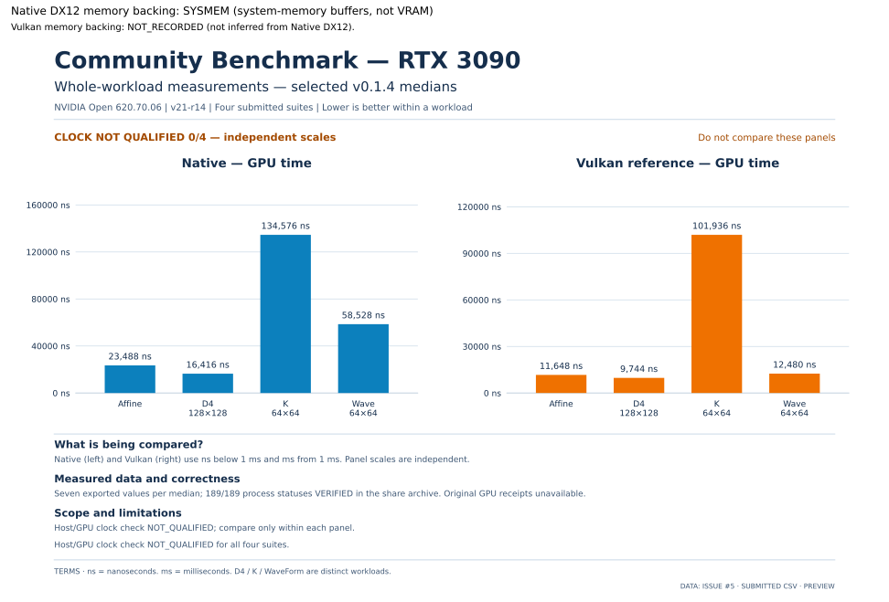

# NVIDIA GeForce RTX 3090 — community results

Community benchmark submissions for the NVIDIA GeForce RTX 3090, newest release first. Each section shows the reported medians and chart of one submission, with its checks and limits.

## Benchmark v0.1.4 results

**Existing v0.1.4 results — Native DX12 memory backing: SYSMEM (system-memory buffers, not VRAM).** This is the documented backing of the release artifact, not independent observation of the submitted host. Vulkan memory backing: **NOT_RECORDED**; do not infer it from Native DX12. [Release evidence](https://github.com/GoblinFlash/Native-DX12-Linux/blob/v0.1.4/NDX12_GPU_Benchmark/README.md#L111). The experimental VRAM candidate is separate.

This folder is reserved for **reviewed community submissions** using the NVIDIA GeForce RTX 3090. RTX 3090 Ti requires a separate category and folder.

One community submission has an archive-consistency review: [Issue #5 — v0.1.4](issue-5.md). Its reported host/GPU clock check is **NOT_QUALIFIED in all four suites**; no native-vs-Vulkan performance comparison is justified by the exported clock check. This does not represent independent GPU replay or universal hardware qualification.

### [Issue #5](https://github.com/GoblinFlash/Native-DX12-Linux/issues/5)

GPU PCI ID: `10de:2204` · Driver: `620.70.06` · Export: **189/189 VERIFIED** · Clock model: **NOT_QUALIFIED in all suites**.

**Important:** all four host/GPU clock checks failed qualification (`HOST_TIMESTAMP_BRACKET` / `GPU_AFTER_HOST_WINDOW`). Keep the two paths separate for performance comparisons on this run.

*Native and Vulkan are charted separately in ns with independent scales. No performance comparison is valid for this submission.*

#### Compute suite

| Workload / native variant | Native SYSMEM median GPU time | Vulkan median GPU time |
| --- | ---: | ---: |
| Affine | 23,488 ns | 11,648 ns |
| Affine N515 | 23,616 ns | 11,680 ns |
| ParallelSort N515 | 1.5 ms | 201,888 ns |

#### Test 1 — D4

| Workload / native variant | Native SYSMEM median GPU time | Vulkan median GPU time |
| --- | ---: | ---: |
| 128×128 Original | 19,952 ns | 9,744 ns |
| 128×128 D4 | 16,416 ns | 9,744 ns |
| 32×512 Original | 40,480 ns | 13,536 ns |
| 32×512 D4 | 26,448 ns | 13,536 ns |
| 16×1024 Original | 68,384 ns | 18,752 ns |
| 16×1024 D4 | 40,096 ns | 18,752 ns |

#### Test 2 — K

| Workload / native variant | Native SYSMEM median GPU time | Vulkan median GPU time |
| --- | ---: | ---: |
| 64×64 scalar | 141,872 ns | 101,936 ns |
| 64×64 uint4 | 134,576 ns | 101,936 ns |
| 127×65 scalar | 291,632 ns | 194,848 ns |
| 127×65 uint4 | 267,760 ns | 194,848 ns |

#### Test 3 — K WaveForm

| Workload / native variant | Native SYSMEM median GPU time | Vulkan median GPU time |
| --- | ---: | ---: |
| 64×64 scalar | 59,792 ns | 12,480 ns |
| 64×64 uint4 | 58,528 ns | 12,480 ns |
| 127×65 scalar | 95,040 ns | 12,736 ns |
| 127×65 uint4 | 94,016 ns | 12,736 ns |

Submitted archive SHA-256: `1728b58997966588d62b7e5f0d12d86d2f0aeab0013545f9613f46de9eba6d87`.

## Submitting a result

Submit a result using the [Benchmark Results form](https://github.com/GoblinFlash/Native-DX12-Linux/issues/new/choose). The GitHub Issue remains the original report; a reviewed summary can be added here only after maintainer approval.

[Submitted results index](../../SUBMISSIONS.md)
