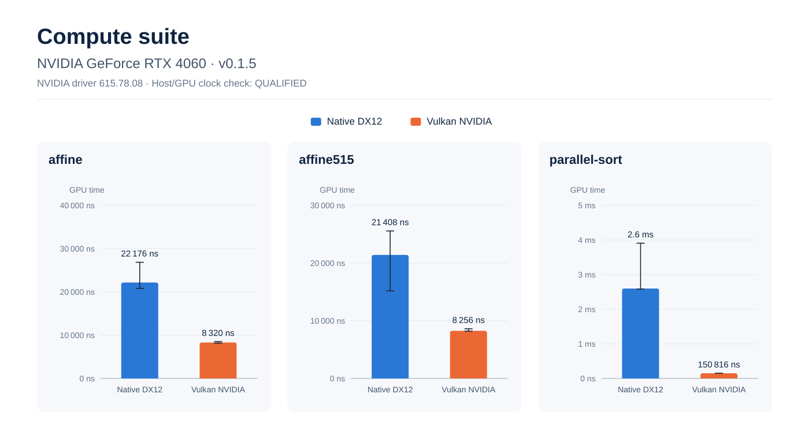

# RTX 4060 — community results

<!-- ndx12:results:NVIDIA/RTX_4060/v0.1.5:start -->
## Benchmark v0.1.5 results

### [Issue #15](https://github.com/GoblinFlash/Native-DX12-Linux/issues/15)

GPU PCI ID: `10de:2882` · Driver: `615.78.08` · Export: **189/189 VERIFIED** · Host/GPU clock check: **QUALIFIED, 4/4 suites**.

**Native DX12 memory backing: SYSMEM (system-memory buffers, not VRAM)**. [Release evidence](https://github.com/GoblinFlash/Native-DX12-Linux/blob/v0.1.5/NDX12_GPU_Benchmark/README.md#L113).

*Selected medians from the four suites; all variants appear in the tables below.*

#### Compute suite

| Workload / native variant | Native SYSMEM median GPU time | Vulkan median GPU time |
| --- | ---: | ---: |
| Affine | 22,176 ns | 8,320 ns |
| Affine N515 | 21,408 ns | 8,256 ns |
| ParallelSort N515 | 2.6 ms | 150,816 ns |

#### Test 1 — D4

| Workload / native variant | Native SYSMEM median GPU time | Vulkan median GPU time |
| --- | ---: | ---: |
| 128×128 Original | 26,848 ns | 6,896 ns |
| 128×128 D4 | 20,336 ns | 6,896 ns |
| 32×512 Original | 64,864 ns | 9,968 ns |
| 32×512 D4 | 37,696 ns | 9,968 ns |
| 16×1024 Original | 118,592 ns | 14,048 ns |
| 16×1024 D4 | 63,760 ns | 14,048 ns |

#### Test 2 — K

| Workload / native variant | Native SYSMEM median GPU time | Vulkan median GPU time |
| --- | ---: | ---: |
| 64×64 scalar | 141,152 ns | 10,496 ns |
| 64×64 uint4 | 111,664 ns | 10,496 ns |
| 127×65 scalar | 320,272 ns | 15,152 ns |
| 127×65 uint4 | 265,264 ns | 15,152 ns |

#### Test 3 — K WaveForm

| Workload / native variant | Native SYSMEM median GPU time | Vulkan median GPU time |
| --- | ---: | ---: |
| 64×64 scalar | 86,336 ns | 9,120 ns |
| 64×64 uint4 | 83,488 ns | 9,120 ns |
| 127×65 scalar | 157,984 ns | 9,264 ns |
| 127×65 uint4 | 154,960 ns | 9,264 ns |

[Full sanitized per-Issue data](v0.1.5/issue-15/README.md) · [All v0.1.5 submissions](../../v0.1.5-submitted-data.md#rtx-4060--issue-15)

Exported statuses and clock checks are reported evidence, not independent GPU qualification.
<!-- ndx12:results:NVIDIA/RTX_4060/v0.1.5:end -->
