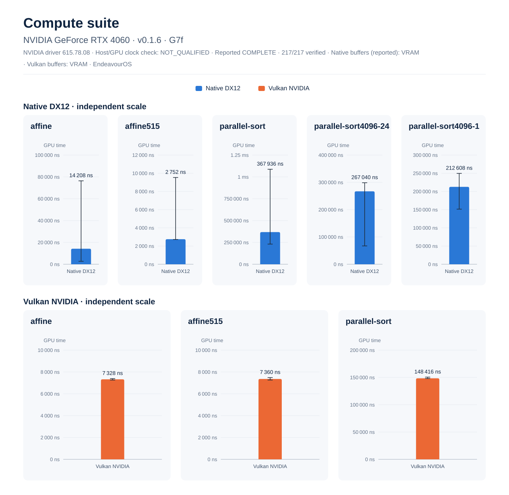
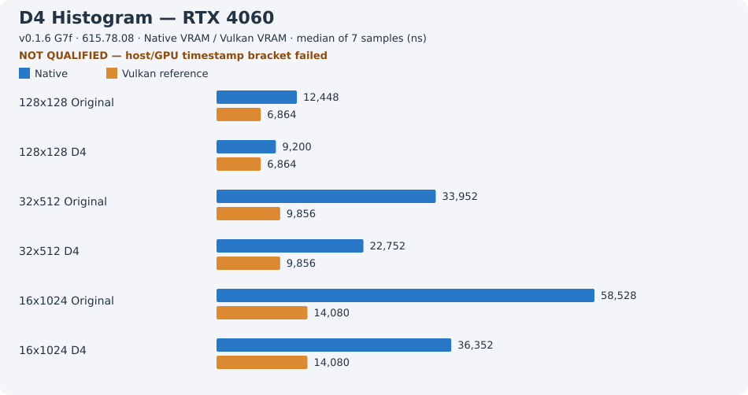
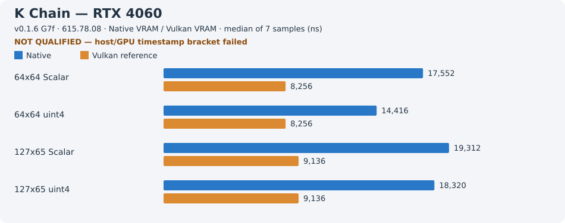
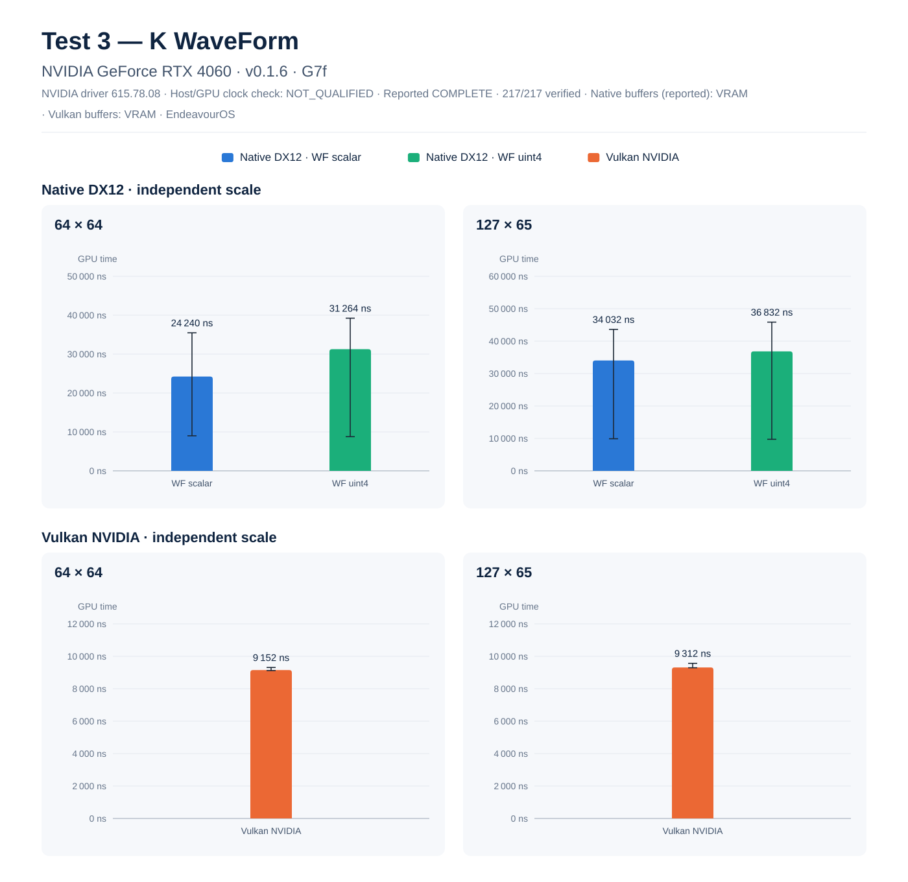
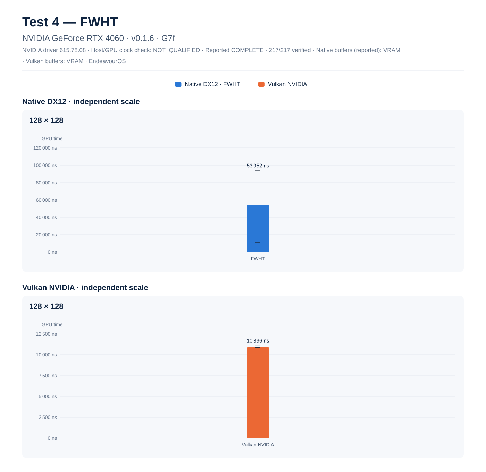

# NVIDIA GeForce RTX 4060 — v0.1.6 (G7f)

Source: [Issue #53](https://github.com/GoblinFlash/Native-DX12-Linux/issues/53) · [Original results attachment](https://github.com/user-attachments/files/35429401/share-results-4060-v0.1.6.tar.gz)

**Historical submission — withdrawn G7f installer, not the current G7az build.** The installer SHA-256 matches the retained G7f artifact. The submission reports a complete run of the five requested suites. Its reported correctness receipts are internally consistent; this is not an independent hardware reproduction.

| Configuration | Recorded value |
| --- | --- |
| GPU | NVIDIA GeForce RTX 4060 (PCI 10de:2882), 8188 MiB |
| OS / kernel | EndeavourOS / 7.3.6-x64v3-xanmod1 |
| Driver | 615.78.08 Open |
| Package | v0.1.6 / v21-r27 / G7f |
| Buffer placement | Native VRAM / Vulkan VRAM |
| Native code | VRAM |
| Clock policy | Unchanged; live telemetry |
| Native session | Retained worker, clean close |
| Reported correctness | 217/217 VERIFIED (Native 140/140, Vulkan 77/77) |
| Failed / held / not run / unknown | 0 / 0 / 0 / 0 |
| Clock qualification | NOT_QUALIFIED in all five suites |

## Reported timings

The medians below are recomputed from the submitted numeric CSV files, in ns. Seven samples per variant. All five suites report `HOST_TIMESTAMP_BRACKET / GPU_AFTER_HOST_WINDOW`. The data are retained for historical diagnosis, not qualified Native/Vulkan speedup claims. No Vulkan counterpart was recorded for the two 4096-element variants. Native kernel-record counts are not available in this export.

### Compute suite

| Case | Native (ns) | Vulkan (ns) |
| --- | ---: | ---: |
| affine | 14,208 | 7,328 |
| affine515 | 2,752 | 7,360 |
| parallel-sort | 367,936 | 148,416 |
| parallel-sort4096-24 | 267,040 | — |
| parallel-sort4096-1 | 212,608 | — |

### D4 Histogram

| Case | Native (ns) | Vulkan (ns) |
| --- | ---: | ---: |
| 128x128 Original | 12,448 | 6,864 |
| 128x128 D4 | 9,200 | 6,864 |
| 32x512 Original | 33,952 | 9,856 |
| 32x512 D4 | 22,752 | 9,856 |
| 16x1024 Original | 58,528 | 14,080 |
| 16x1024 D4 | 36,352 | 14,080 |

### K Chain

| Case | Native (ns) | Vulkan (ns) |
| --- | ---: | ---: |
| 64x64 Scalar | 17,552 | 8,256 |
| 64x64 uint4 | 14,416 | 8,256 |
| 127x65 Scalar | 19,312 | 9,136 |
| 127x65 uint4 | 18,320 | 9,136 |

### K WaveForm

| Case | Native (ns) | Vulkan (ns) |
| --- | ---: | ---: |
| 64x64 Scalar | 24,240 | 9,152 |
| 64x64 uint4 | 31,264 | 9,152 |
| 127x65 Scalar | 34,032 | 9,312 |
| 127x65 uint4 | 36,832 | 9,312 |

### FWHT

| Case | Native (ns) | Vulkan (ns) |
| --- | ---: | ---: |
| 128x128 FWHT | 53,952 | 10,896 |

## Provenance

- Results attachment SHA-256: `2298988e9b09541963fcda128a8c69a018d42a363979954583e4c4c71d56e483`
- Installer SHA-256: `9bb684e7acba9b8ef7ba072f3bab21d2c592e75b27e7fc46892bfa0ca356bd3b`
- Package archive SHA-256: `da95d01942dc021bdd3fa95fb09ff59b014b9740dde8b42614a1742e2f7acab8`
- Manifest SHA-256: `c7f4e33ebcdbdfc4439077ced1ddc4e4f33eb8a26e5e0688bd056c2bf8d8a976` (7185 files reported matching).

The checked numeric CSV files are preserved alongside this page. Charts were regenerated from those data; no uploaded SVG or HTML was copied. This manual historical entry is excluded from automated aggregate records. The current intake catalog does not recognize v0.1.6.
