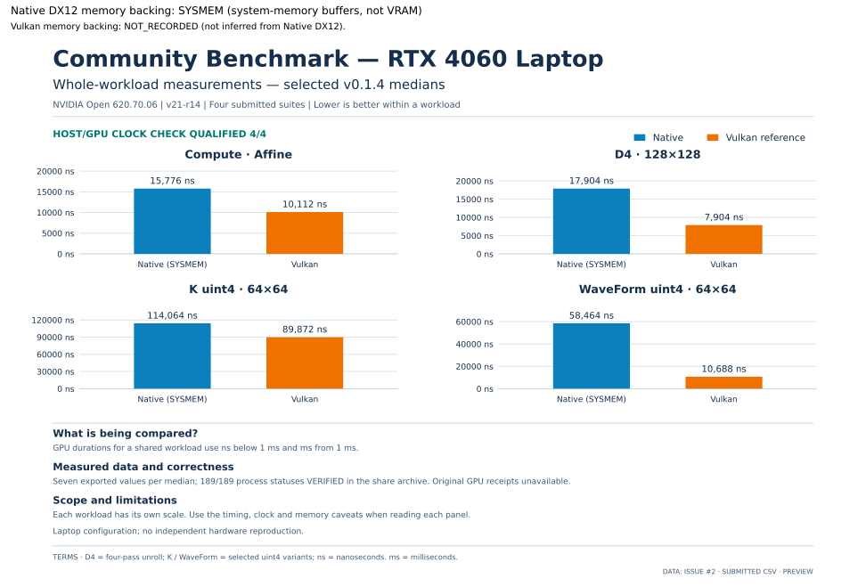

# NVIDIA GeForce RTX 4060 Laptop GPU — community results

Community benchmark submissions for the NVIDIA GeForce RTX 4060 Laptop GPU, newest release first. Each section shows the reported medians and chart of one submission, with its checks and limits.

## Benchmark v0.1.4 results

**Existing v0.1.4 results — Native DX12 memory backing: SYSMEM (system-memory buffers, not VRAM).** This is the documented backing of the release artifact, not independent observation of the submitted host. Vulkan memory backing: **NOT_RECORDED**; do not infer it from Native DX12. [Release evidence](https://github.com/GoblinFlash/Native-DX12-Linux/blob/v0.1.4/NDX12_GPU_Benchmark/README.md#L111). The experimental VRAM candidate is separate.

**Archive-consistency checked** submission:

- [Issue #2 — v0.1.4 benchmark](issue-2.md), reported on RTX 4060 Laptop GPU (PCI 10de:28e0).

This is a laptop model, not the desktop RTX 4060. The shared summary and CSV were checked for internal consistency, but this was **not** an independently repeated GPU test.

### [Issue #2](https://github.com/GoblinFlash/Native-DX12-Linux/issues/2)

GPU PCI ID: `10de:28e0` · Driver: `620.70.06` · Export: **189/189 VERIFIED** · Clock model: **QUALIFIED in all suites**.

Laptop configuration on Arch Linux. No independent hardware reproduction was performed.

*Selected medians from the four suites; all recorded variants appear in the tables below.*

#### Compute suite

| Workload / native variant | Native SYSMEM median GPU time | Vulkan median GPU time |
| --- | ---: | ---: |
| Affine | 15,776 ns | 10,112 ns |
| Affine N515 | 15,680 ns | 9,856 ns |
| ParallelSort N515 | 2.52 ms | 191,008 ns |

#### Test 1 — D4

| Workload / native variant | Native SYSMEM median GPU time | Vulkan median GPU time |
| --- | ---: | ---: |
| 128×128 Original | 24,832 ns | 7,904 ns |
| 128×128 D4 | 17,904 ns | 7,904 ns |
| 32×512 Original | 65,296 ns | 11,696 ns |
| 32×512 D4 | 37,632 ns | 11,696 ns |
| 16×1024 Original | 119,952 ns | 16,720 ns |
| 16×1024 D4 | 64,256 ns | 16,720 ns |

#### Test 2 — K

| Workload / native variant | Native SYSMEM median GPU time | Vulkan median GPU time |
| --- | ---: | ---: |
| 64×64 scalar | 117,184 ns | 89,872 ns |
| 64×64 uint4 | 114,064 ns | 89,872 ns |
| 127×65 scalar | 217,584 ns | 173,456 ns |
| 127×65 uint4 | 214,688 ns | 173,456 ns |

#### Test 3 — K WaveForm

| Workload / native variant | Native SYSMEM median GPU time | Vulkan median GPU time |
| --- | ---: | ---: |
| 64×64 scalar | 61,632 ns | 10,688 ns |
| 64×64 uint4 | 58,464 ns | 10,688 ns |
| 127×65 scalar | 75,376 ns | 10,928 ns |
| 127×65 uint4 | 72,032 ns | 10,928 ns |

Submitted archive SHA-256: `5f32e1b4e96bfcca6051a8662e59b02e8ccd47088c120b1f6f82f5f2a8a518b0`.

[All community GPU results](../../README.md)
