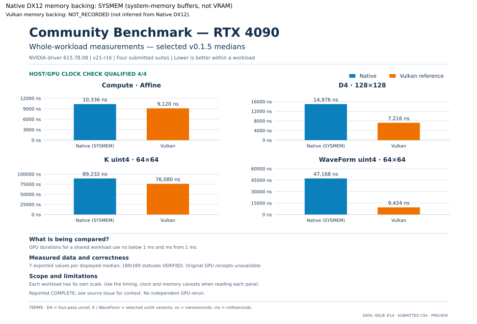

# NVIDIA GeForce RTX 4090 — community results

Community benchmark submissions for the desktop NVIDIA GeForce RTX 4090, newest release first. RTX 4090 Laptop GPU and RTX 4090 D require separate categories and folders. Each section shows the reported medians and chart of one submission, with its checks and limits.

<!-- ndx12:results:NVIDIA/RTX_4090/v0.1.5:start -->
## Benchmark v0.1.5 results

### [Issue #14](https://github.com/GoblinFlash/Native-DX12-Linux/issues/14)

GPU PCI ID: `10de:2684` · Driver: `615.78.08` · Export: **189/189 VERIFIED** · Host/GPU clock check: **QUALIFIED, 4/4 suites**.

**Native DX12 memory backing: SYSMEM (system-memory buffers, not VRAM)**. [Release evidence](https://github.com/GoblinFlash/Native-DX12-Linux/blob/v0.1.5/NDX12_GPU_Benchmark/README.md#L113).

*Selected medians from the four suites; all variants appear in the tables below.*

#### Compute suite

| Workload / native variant | Native SYSMEM median GPU time | Vulkan median GPU time |
| --- | ---: | ---: |
| Affine | 10,336 ns | 9,120 ns |
| Affine N515 | 9,984 ns | 8,800 ns |
| ParallelSort N515 | 2.16 ms | 150,176 ns |

#### Test 1 — D4

| Workload / native variant | Native SYSMEM median GPU time | Vulkan median GPU time |
| --- | ---: | ---: |
| 128×128 Original | 21,104 ns | 7,216 ns |
| 128×128 D4 | 14,976 ns | 7,216 ns |
| 32×512 Original | 56,448 ns | 10,272 ns |
| 32×512 D4 | 32,128 ns | 10,272 ns |
| 16×1024 Original | 104,496 ns | 14,560 ns |
| 16×1024 D4 | 55,520 ns | 14,560 ns |

#### Test 2 — K

| Workload / native variant | Native SYSMEM median GPU time | Vulkan median GPU time |
| --- | ---: | ---: |
| 64×64 scalar | 92,160 ns | 76,080 ns |
| 64×64 uint4 | 89,232 ns | 76,080 ns |
| 127×65 scalar | 165,856 ns | 148,576 ns |
| 127×65 uint4 | 163,856 ns | 148,576 ns |

#### Test 3 — K WaveForm

| Workload / native variant | Native SYSMEM median GPU time | Vulkan median GPU time |
| --- | ---: | ---: |
| 64×64 scalar | 49,744 ns | 9,424 ns |
| 64×64 uint4 | 47,168 ns | 9,424 ns |
| 127×65 scalar | 57,680 ns | 9,632 ns |
| 127×65 uint4 | 55,136 ns | 9,632 ns |

[Full sanitized per-Issue data](v0.1.5/issue-14/README.md) · [All v0.1.5 submissions](../../v0.1.5-submitted-data.md#rtx-4090--issue-14)

Exported statuses and clock checks are reported evidence, not independent GPU qualification.
<!-- ndx12:results:NVIDIA/RTX_4090/v0.1.5:end -->

## Submitting a result

Submit a result using the [Benchmark Results form](https://github.com/GoblinFlash/Native-DX12-Linux/issues/new/choose). The GitHub Issue remains the original report; a reviewed summary can be added here only after maintainer approval.

[Submitted results index](../../SUBMISSIONS.md)
