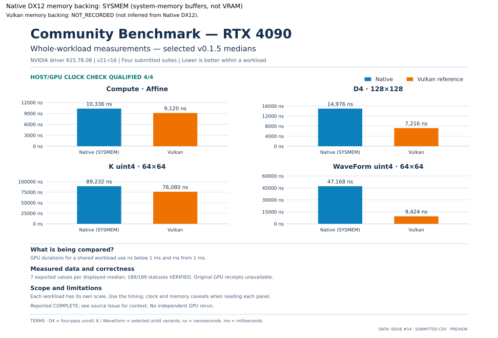

# Community submission — Issue #14

**Export consistency: CHECKED**
**Owner acceptance: NOT_RECORDED**

CHECKED refers to export consistency, not a successful or independently verified GPU run.
Intake does not record owner acceptance or infer it from a merged PR.

Source: [Issue #14](https://github.com/GoblinFlash/Native-DX12-Linux/issues/14)

**Native DX12 memory backing: SYSMEM (system-memory buffers, not VRAM)**
Vulkan memory backing: NOT_RECORDED; Native placement is not attributed to the reference.
Backing is classified from documented release identity, not independently observed host allocations.

| Field | Intake observation |
| --- | --- |
| State | DATA_READY |
| Reason | OK |
| Claimed GPU | NVIDIA/RTX_4090 |
| Archive GPU | NVIDIA/RTX_4090 |
| Claimed release | v0.1.5 |
| Archive release | v0.1.5 |
| Driver | 615.78.08 |

Model/PCI field consistency is checked against pinned vendor data; this is not hardware authentication.

The source Issue and attachment are untrusted reports. Matching catalog fields and recalculated
medians do not authenticate the machine, receipt provenance, GPU readbacks or execution.
Review background contention and all reporter notes in the Issue; they are not copied here.
Actual per-dispatch clocks are not proven. GPU durations are shown in ns below 1 ms and in ms from 1 ms.
A reported 189/189 VERIFIED count is not independent GPU qualification.

Reported overall state: `COMPLETE`; failure marker present: `false`.

## Reported process counts

| Suite | Expected | VERIFIED (reported) | FAIL | HELD | NOT_RUN | UNKNOWN | Reported clock check |
| --- | ---: | ---: | ---: | ---: | ---: | ---: | --- |
| compute | 42 | 42 | 0 | 0 | 0 | 0 | QUALIFIED |
| d4 | 63 | 63 | 0 | 0 | 0 | 0 | QUALIFIED |
| k | 42 | 42 | 0 | 0 | 0 | 0 | QUALIFIED |
| kw | 42 | 42 | 0 | 0 | 0 | 0 | QUALIFIED |

## Recalculated exported measurements

Medians below are calculated from exported per-process values, not from uploaded prose or charts.
Frame-suite values are medians of process medians. No uploaded HTML, image or raw log is reused.

| Suite | Case | Variant | Path | n | Median GPU time |
| --- | --- | --- | --- | ---: | ---: |
| compute | affine |  | native | 7 | 10336 ns |
| compute | affine |  | vulkan | 7 | 9120 ns |
| compute | affine515 |  | native | 7 | 9984 ns |
| compute | affine515 |  | vulkan | 7 | 8800 ns |
| compute | parallel-sort |  | native | 7 | 2.16 ms |
| compute | parallel-sort |  | vulkan | 7 | 150176 ns |
| d4 | 128x128 |  | vulkan | 7 | 7216 ns |
| d4 | 128x128 | B | native | 7 | 21104 ns |
| d4 | 128x128 | D4 | native | 7 | 14976 ns |
| d4 | 16x1024 |  | vulkan | 7 | 14560 ns |
| d4 | 16x1024 | B | native | 7 | 104496 ns |
| d4 | 16x1024 | D4 | native | 7 | 55520 ns |
| d4 | 32x512 |  | vulkan | 7 | 10272 ns |
| d4 | 32x512 | B | native | 7 | 56448 ns |
| d4 | 32x512 | D4 | native | 7 | 32128 ns |
| k | 127x65 |  | vulkan | 7 | 148576 ns |
| k | 127x65 | root-scalar | native | 7 | 165856 ns |
| k | 127x65 | root-uint4 | native | 7 | 163856 ns |
| k | 64x64 |  | vulkan | 7 | 76080 ns |
| k | 64x64 | root-scalar | native | 7 | 92160 ns |
| k | 64x64 | root-uint4 | native | 7 | 89232 ns |
| kw | 127x65 |  | vulkan | 7 | 9632 ns |
| kw | 127x65 | wave-root-scalar | native | 7 | 57680 ns |
| kw | 127x65 | wave-root-uint4 | native | 7 | 55136 ns |
| kw | 64x64 |  | vulkan | 7 | 9424 ns |
| kw | 64x64 | wave-root-scalar | native | 7 | 49744 ns |
| kw | 64x64 | wave-root-uint4 | native | 7 | 47168 ns |

[Open SVG](chart.svg). Full sanitized data: [measurements.csv](measurements.csv),
[summary.csv](summary.csv), [processes.csv](processes.csv).

## Mandatory caveats

- BACKGROUND_NOT_ASSESSED
- CLOCKS_NOT_PROVEN_PER_DISPATCH
- IDENTITY_SELF_REPORTED
- NO_INDEPENDENT_GPU_RERUN
- RAW_READBACKS_NOT_INCLUDED
- REVIEW_ISSUE_CONTEXT
- SEPARATE_TIMING_UNITS
- UNVERIFIED_SUBMISSION

Owner acceptance is a separate manual decision; this import does not record it.
Intake approval labels authorize processing only; they do not accept these results.
