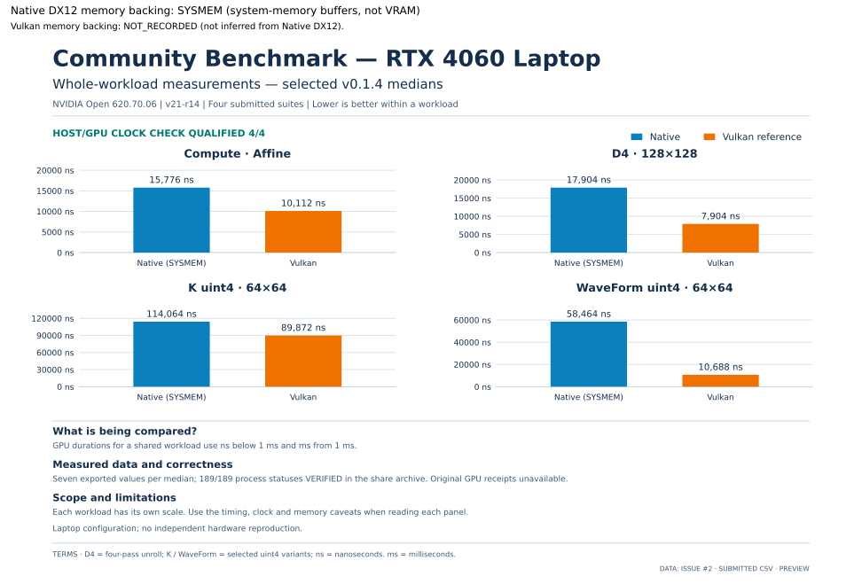

# Community benchmark v0.1.4 — submitted measurement data

**Existing v0.1.4 results — Native DX12 memory backing: SYSMEM (system-memory buffers, not VRAM).** This is the documented backing of the release artifact, not independent observation of the submitted host. Vulkan memory backing: **NOT_RECORDED**; do not infer it from Native DX12. [Release evidence](https://github.com/GoblinFlash/Native-DX12-Linux/blob/v0.1.4/NDX12_GPU_Benchmark/README.md#L111). The experimental VRAM candidate is separate.

Updated: 11 November 2026. **Source:** four public `share-results-v0.1.4.tar.gz` attachments linked from Issues #2–#5. This page reports data **extracted from those archives**, not an independent GPU rerun or approval of every submission.

All four exports identify benchmark **v0.1.4 / v21-r14**, NVIDIA Open driver **620.70.06**, and **189/189 exported process statuses VERIFIED** (119 native, 70 Vulkan reference). The runner's original per-process GPU receipts are not included in these public share archives.

## Submission overview

| Reported GPU | Source | Exported process statuses | Reported host/GPU clock check | Limitation |
| --- | --- | --- | --- | --- |
| RTX 3060 | [Issue #4](https://github.com/GoblinFlash/Native-DX12-Linux/issues/4) | 189/189 VERIFIED | QUALIFIED, 4/4 suites | Model and kernel message clarified by reporter; maintainer acceptance pending |
| RTX 3060 Ti | [Issue #3](https://github.com/GoblinFlash/Native-DX12-Linux/issues/3) | 189/189 VERIFIED | QUALIFIED, 4/4 suites | ONNX inference service shared the GPU |
| RTX 3090 | [Issue #5](https://github.com/GoblinFlash/Native-DX12-Linux/issues/5) | 189/189 VERIFIED | **NOT_QUALIFIED, 4/4 suites** | No native-versus-Vulkan performance ratios permitted |
| RTX 4060 Laptop GPU | [Issue #2](https://github.com/GoblinFlash/Native-DX12-Linux/issues/2) | 189/189 VERIFIED | QUALIFIED, 4/4 suites | Laptop configuration; no independent rerun |

## How to read these numbers

- **Native** and **Vulkan** GPU durations use **ns** below 1 ms and **ms** from 1 ms. The reported host/GPU clock check is a separate comparison criterion.
- Each number is the **median of seven process/sample values** for the named workload. D4, K and WaveForm values are medians of process medians, from full-work GPU timing that includes synchronization, not isolated shader timings.
- These tables show measured values without ranking different GPUs or computing speedups from medians. The release's paired-repeat, clock-qualification and CLEAR tests are the authority for within-run directional claims.
- Different machines, background loads and clock behavior make cross-GPU performance comparisons invalid without a controlled protocol. The RTX 3090's columns must **not** be divided to calculate an advantage or disadvantage.

## RTX 3060 

GPU PCI ID: `10de:2503` · Driver: `620.70.06` · Export: **189/189 VERIFIED** · Clock model: **QUALIFIED in all suites**.

*Selected medians from the four suites; all recorded variants appear in the tables below.*

### Compute suite

| Workload / native variant | Native SYSMEM median GPU time | Vulkan median GPU time |
| --- | ---: | ---: |
| Affine | 32,512 ns | 9,536 ns |
| Affine N515 | 22,752 ns | 9,568 ns |
| ParallelSort N515 | 2.61 ms | 181,856 ns |

### Test 1 — D4

| Workload / native variant | Native SYSMEM median GPU time | Vulkan median GPU time |
| --- | ---: | ---: |
| 128×128 Original | 27,504 ns | 7,568 ns |
| 128×128 D4 | 20,688 ns | 7,568 ns |
| 32×512 Original | 67,376 ns | 11,008 ns |
| 32×512 D4 | 40,192 ns | 11,008 ns |
| 16×1024 Original | 121,104 ns | 15,760 ns |
| 16×1024 D4 | 66,512 ns | 15,760 ns |

### Test 2 — K

| Workload / native variant | Native SYSMEM median GPU time | Vulkan median GPU time |
| --- | ---: | ---: |
| 64×64 scalar | 117,744 ns | 74,224 ns |
| 64×64 uint4 | 108,128 ns | 74,224 ns |
| 127×65 scalar | 239,328 ns | 144,240 ns |
| 127×65 uint4 | 215,072 ns | 144,240 ns |

### Test 3 — K WaveForm

| Workload / native variant | Native SYSMEM median GPU time | Vulkan median GPU time |
| --- | ---: | ---: |
| 64×64 scalar | 76,928 ns | 10,144 ns |
| 64×64 uint4 | 74,288 ns | 10,144 ns |
| 127×65 scalar | 113,264 ns | 10,512 ns |
| 127×65 uint4 | 110,112 ns | 10,512 ns |

Submitted archive SHA-256: `96d095c11364e83cf196144c9aac341c1a7a0be43355ef90820b9a9a8ff29345`.

## RTX 3060 Ti — [Issue #3](https://github.com/GoblinFlash/Native-DX12-Linux/issues/3)

GPU PCI ID: `10de:2489` · Driver: `620.70.06` · Export: **189/189 VERIFIED** · Clock model: **QUALIFIED in all suites**.

The reporter disclosed a continuously running ONNX object-detection service on the same GPU. These medians are **not an idle-GPU baseline**.

*Selected medians from the four suites; all recorded variants appear in the tables below.*

### Compute suite

| Workload / native variant | Native SYSMEM median GPU time | Vulkan median GPU time |
| --- | ---: | ---: |
| Affine | 6,720 ns | 10,336 ns |
| Affine N515 | 7,040 ns | 10,208 ns |
| ParallelSort N515 | 477,184 ns | 194,560 ns |

### Test 1 — D4

| Workload / native variant | Native SYSMEM median GPU time | Vulkan median GPU time |
| --- | ---: | ---: |
| 128×128 Original | 6,688 ns | 7,936 ns |
| 128×128 D4 | 5,728 ns | 7,936 ns |
| 32×512 Original | 11,920 ns | 11,584 ns |
| 32×512 D4 | 8,128 ns | 11,584 ns |
| 16×1024 Original | 19,344 ns | 16,560 ns |
| 16×1024 D4 | 11,728 ns | 16,560 ns |

### Test 2 — K

| Workload / native variant | Native SYSMEM median GPU time | Vulkan median GPU time |
| --- | ---: | ---: |
| 64×64 scalar | 31,152 ns | 16,912 ns |
| 64×64 uint4 | 27,632 ns | 16,912 ns |
| 127×65 scalar | 66,416 ns | 28,336 ns |
| 127×65 uint4 | 59,168 ns | 28,336 ns |

### Test 3 — K WaveForm

| Workload / native variant | Native SYSMEM median GPU time | Vulkan median GPU time |
| --- | ---: | ---: |
| 64×64 scalar | 22,448 ns | 10,624 ns |
| 64×64 uint4 | 22,096 ns | 10,624 ns |
| 127×65 scalar | 36,448 ns | 10,912 ns |
| 127×65 uint4 | 36,032 ns | 10,912 ns |

Submitted archive SHA-256: `1a2e6db004472d83194e25ca09180b725ddc483a4ae78a2f7a2c2abcc9ffeba7`.

## RTX 3090

GPU PCI ID: `10de:2204` · Driver: `620.70.06` · Export: **189/189 VERIFIED** · Clock model: **NOT_QUALIFIED in all suites**.

**Important:** all four host/GPU clock checks failed qualification (`HOST_TIMESTAMP_BRACKET` / `GPU_AFTER_HOST_WINDOW`). Keep the two paths separate for performance comparisons on this run.

*Native and Vulkan are charted separately in ns with independent scales. No performance comparison is valid for this submission.*

### Compute suite

| Workload / native variant | Native SYSMEM median GPU time | Vulkan median GPU time |
| --- | ---: | ---: |
| Affine | 23,488 ns | 11,648 ns |
| Affine N515 | 23,616 ns | 11,680 ns |
| ParallelSort N515 | 1.5 ms | 201,888 ns |

### Test 1 — D4

| Workload / native variant | Native SYSMEM median GPU time | Vulkan median GPU time |
| --- | ---: | ---: |
| 128×128 Original | 19,952 ns | 9,744 ns |
| 128×128 D4 | 16,416 ns | 9,744 ns |
| 32×512 Original | 40,480 ns | 13,536 ns |
| 32×512 D4 | 26,448 ns | 13,536 ns |
| 16×1024 Original | 68,384 ns | 18,752 ns |
| 16×1024 D4 | 40,096 ns | 18,752 ns |

### Test 2 — K

| Workload / native variant | Native SYSMEM median GPU time | Vulkan median GPU time |
| --- | ---: | ---: |
| 64×64 scalar | 141,872 ns | 101,936 ns |
| 64×64 uint4 | 134,576 ns | 101,936 ns |
| 127×65 scalar | 291,632 ns | 194,848 ns |
| 127×65 uint4 | 267,760 ns | 194,848 ns |

### Test 3 — K WaveForm

| Workload / native variant | Native SYSMEM median GPU time | Vulkan median GPU time |
| --- | ---: | ---: |
| 64×64 scalar | 59,792 ns | 12,480 ns |
| 64×64 uint4 | 58,528 ns | 12,480 ns |
| 127×65 scalar | 95,040 ns | 12,736 ns |
| 127×65 uint4 | 94,016 ns | 12,736 ns |

Submitted archive SHA-256: `1728b58997966588d62b7e5f0d12d86d2f0aeab0013545f9613f46de9eba6d87`.

## RTX 4060 Laptop GPU

GPU PCI ID: `10de:28e0` · Driver: `620.70.06` · Export: **189/189 VERIFIED** · Clock model: **QUALIFIED in all suites**.

Laptop configuration on Arch Linux. No independent hardware reproduction was performed.

*Selected medians from the four suites; all recorded variants appear in the tables below.*

### Compute suite

| Workload / native variant | Native SYSMEM median GPU time | Vulkan median GPU time |
| --- | ---: | ---: |
| Affine | 15,776 ns | 10,112 ns |
| Affine N515 | 15,680 ns | 9,856 ns |
| ParallelSort N515 | 2.52 ms | 191,008 ns |

### Test 1 — D4

| Workload / native variant | Native SYSMEM median GPU time | Vulkan median GPU time |
| --- | ---: | ---: |
| 128×128 Original | 24,832 ns | 7,904 ns |
| 128×128 D4 | 17,904 ns | 7,904 ns |
| 32×512 Original | 65,296 ns | 11,696 ns |
| 32×512 D4 | 37,632 ns | 11,696 ns |
| 16×1024 Original | 119,952 ns | 16,720 ns |
| 16×1024 D4 | 64,256 ns | 16,720 ns |

### Test 2 — K

| Workload / native variant | Native SYSMEM median GPU time | Vulkan median GPU time |
| --- | ---: | ---: |
| 64×64 scalar | 117,184 ns | 89,872 ns |
| 64×64 uint4 | 114,064 ns | 89,872 ns |
| 127×65 scalar | 217,584 ns | 173,456 ns |
| 127×65 uint4 | 214,688 ns | 173,456 ns |

### Test 3 — K WaveForm

| Workload / native variant | Native SYSMEM median GPU time | Vulkan median GPU time |
| --- | ---: | ---: |
| 64×64 scalar | 61,632 ns | 10,688 ns |
| 64×64 uint4 | 58,464 ns | 10,688 ns |
| 127×65 scalar | 75,376 ns | 10,928 ns |
| 127×65 uint4 | 72,032 ns | 10,928 ns |

Submitted archive SHA-256: `5f32e1b4e96bfcca6051a8662e59b02e8ccd47088c120b1f6f82f5f2a8a518b0`.

## Verification and limits

The four archives were read **without executing their contents**. Checks covered archive SHA-256, member names, `run.json` GPU identities and suite clock states, 189 CSV process rows per export, and the numerical CSV tables. Every published median above was recomputed from seven exported values. Original per-process logs, independent GPU dispatch/readback and actual dispatch clocks were not revalidated here.

[Submitted benchmark index](SUBMISSIONS.md) · [All benchmark results](README.md) · [Project home](../README.md)
