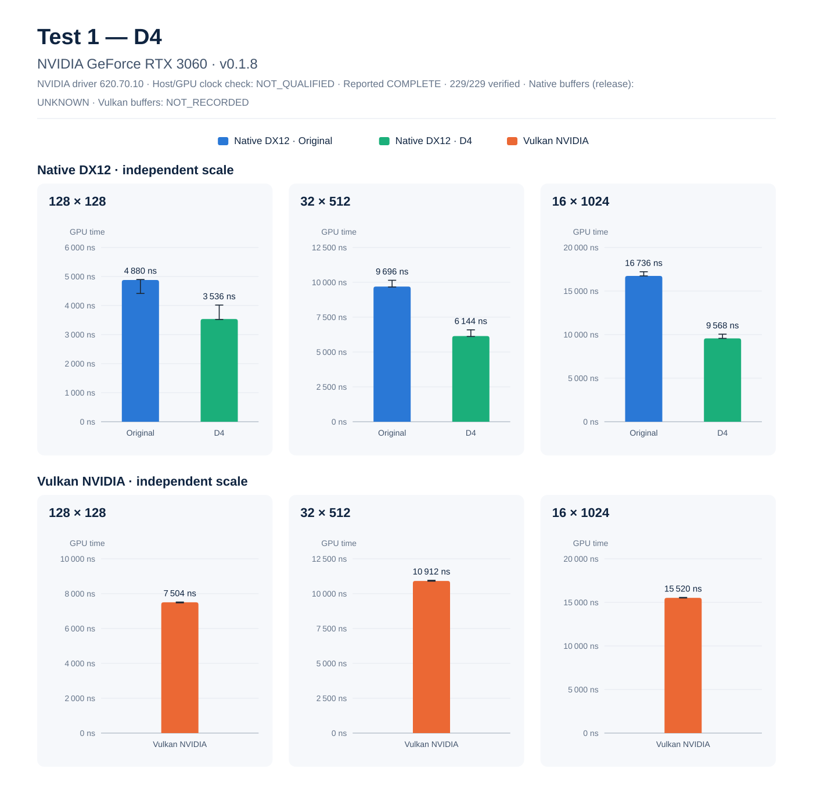
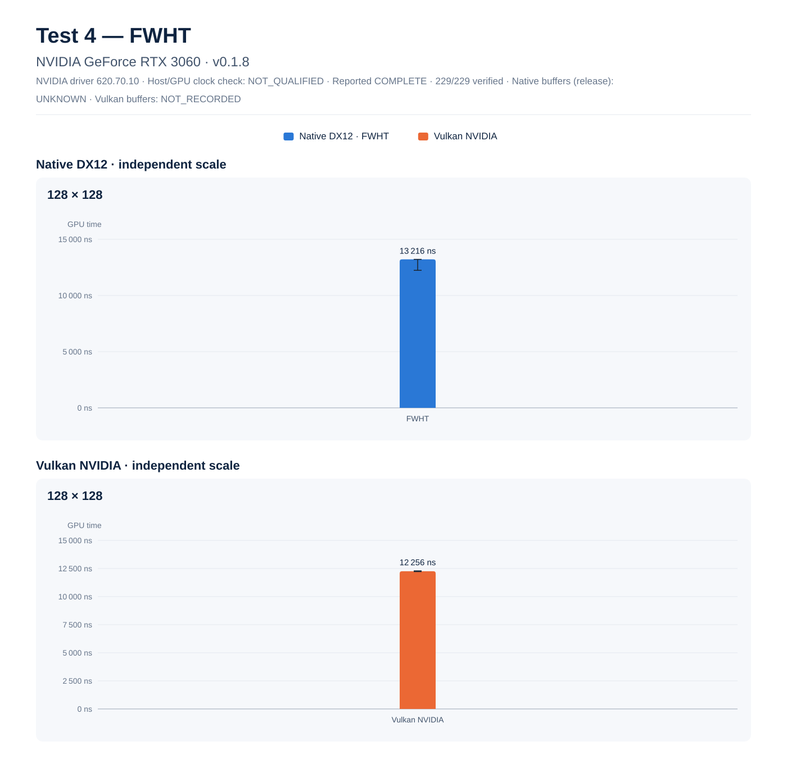
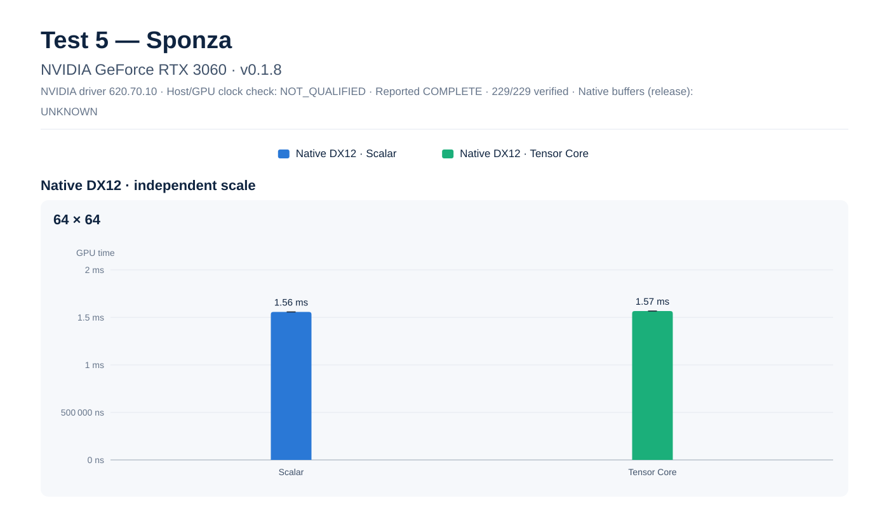
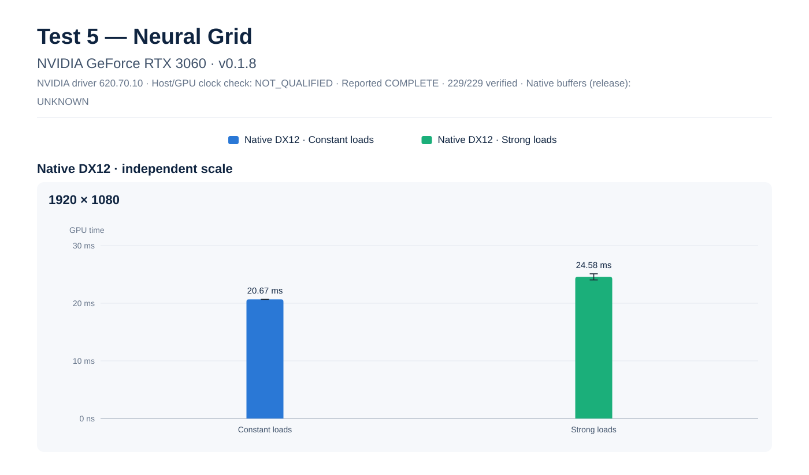
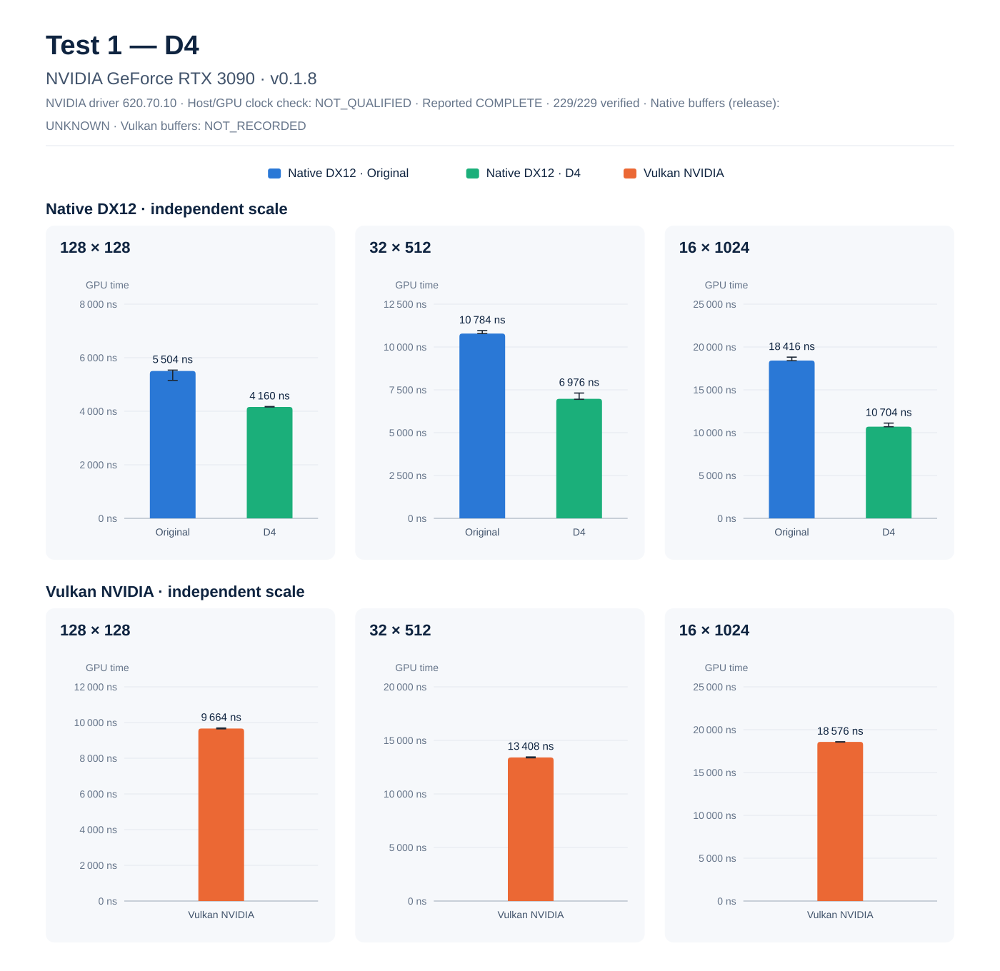
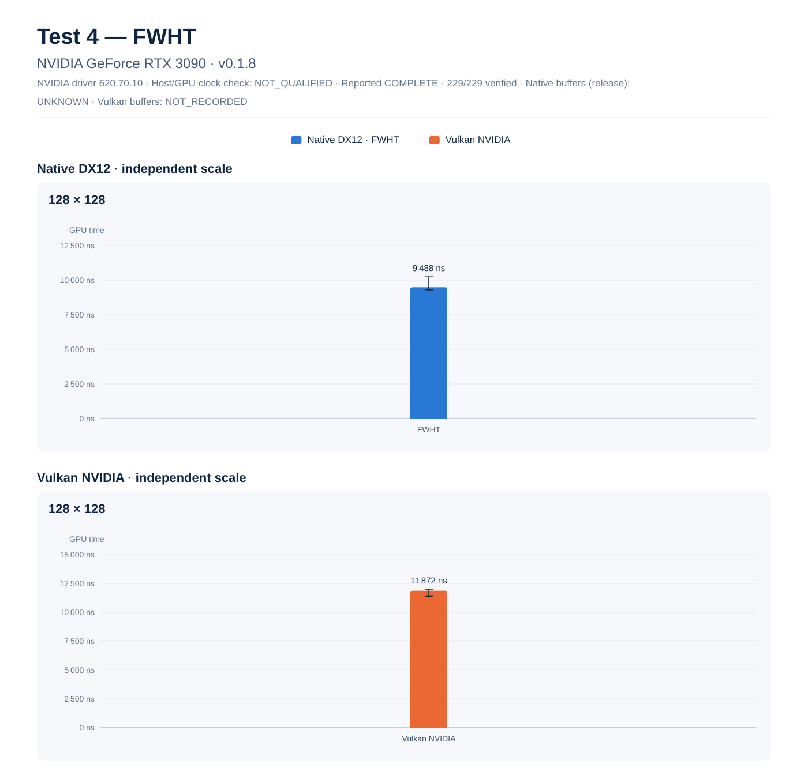
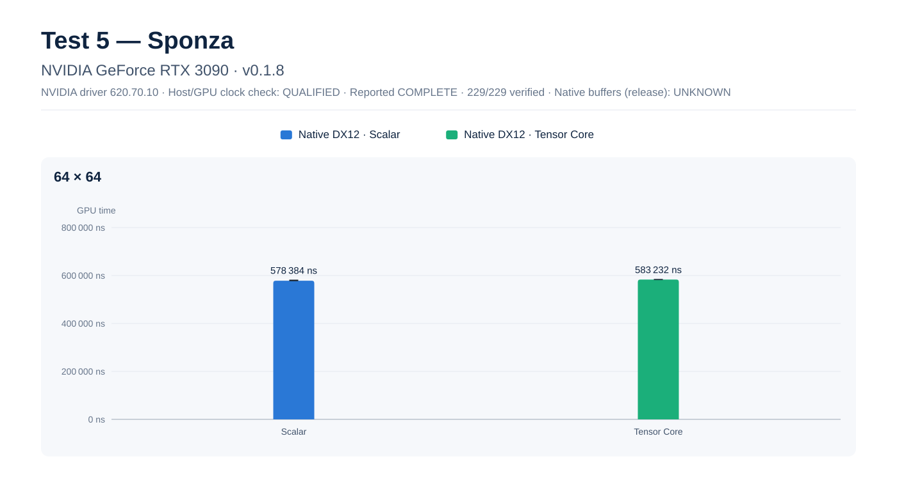
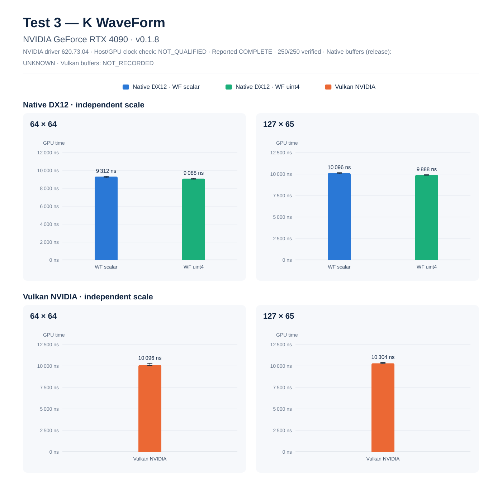

<!-- ndx12:aggregate:v0.1.8:start -->
# Benchmark v0.1.8

## NVIDIA GeForce RTX 3060 · v0.1.8

## NVIDIA GeForce RTX 3090 · v0.1.8

## NVIDIA GeForce RTX 4090 · v0.1.8

<!-- ndx12:aggregate:v0.1.8:end -->
