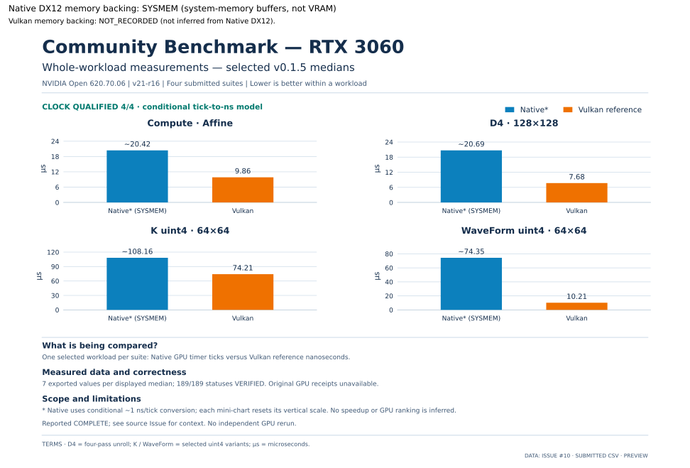

# Community submission — Issue #10

**Export consistency: CHECKED**
**Owner acceptance: NOT_RECORDED**

CHECKED refers to export consistency, not a successful or independently verified GPU run.
Intake does not record owner acceptance or infer it from a merged PR.

Source: [Issue #10](https://github.com/GoblinFlash/Native-DX12-Linux/issues/10)

**Native DX12 memory backing: SYSMEM (system-memory buffers, not VRAM)**
Vulkan memory backing: NOT_RECORDED; Native placement is not attributed to the reference.
Backing is classified from documented release identity, not independently observed host allocations.

| Field | Intake observation |
| --- | --- |
| State | DATA_READY |
| Reason | OK |
| Claimed GPU | NVIDIA/RTX_3060 |
| Archive GPU | NVIDIA/RTX_3060 |
| Claimed release | v0.1.5 |
| Archive release | v0.1.5 |
| Driver | 620.70.06 |

Model/PCI field consistency is checked against pinned vendor data; this is not hardware authentication.

The source Issue and attachment are untrusted reports. Matching catalog fields and recalculated
medians do not authenticate the machine, receipt provenance, GPU readbacks or execution.
Review background contention and all reporter notes in the Issue; they are not copied here.
Actual per-dispatch clocks are not proven. Native GPU ticks and Vulkan nanoseconds stay separate.
A reported 189/189 VERIFIED count is not independent GPU qualification.

Reported overall state: `COMPLETE`; failure marker present: `false`.

## Reported process counts

| Suite | Expected | VERIFIED (reported) | FAIL | HELD | NOT_RUN | UNKNOWN | Reported clock check |
| --- | ---: | ---: | ---: | ---: | ---: | ---: | --- |
| compute | 42 | 42 | 0 | 0 | 0 | 0 | QUALIFIED |
| d4 | 63 | 63 | 0 | 0 | 0 | 0 | QUALIFIED |
| k | 42 | 42 | 0 | 0 | 0 | 0 | QUALIFIED |
| kw | 42 | 42 | 0 | 0 | 0 | 0 | QUALIFIED |

## Recalculated exported measurements

Medians below are calculated from exported per-process values, not from uploaded prose or charts.
Frame-suite values are medians of process medians. No uploaded HTML, image or raw log is reused.

| Suite | Case | Variant | Path | Unit | n | Median |
| --- | --- | --- | --- | --- | ---: | ---: |
| compute | affine |  | native | GPU_TICKS | 7 | 20416 |
| compute | affine |  | vulkan | NS | 7 | 9856 |
| compute | affine515 |  | native | GPU_TICKS | 7 | 32416 |
| compute | affine515 |  | vulkan | NS | 7 | 9664 |
| compute | parallel-sort |  | native | GPU_TICKS | 7 | 2610240 |
| compute | parallel-sort |  | vulkan | NS | 7 | 182336 |
| d4 | 128x128 |  | vulkan | NS | 7 | 7680 |
| d4 | 128x128 | B | native | GPU_TICKS | 7 | 27568 |
| d4 | 128x128 | D4 | native | GPU_TICKS | 7 | 20688 |
| d4 | 16x1024 |  | vulkan | NS | 7 | 15840 |
| d4 | 16x1024 | B | native | GPU_TICKS | 7 | 121104 |
| d4 | 16x1024 | D4 | native | GPU_TICKS | 7 | 66544 |
| d4 | 32x512 |  | vulkan | NS | 7 | 10976 |
| d4 | 32x512 | B | native | GPU_TICKS | 7 | 67408 |
| d4 | 32x512 | D4 | native | GPU_TICKS | 7 | 40208 |
| k | 127x65 |  | vulkan | NS | 7 | 143552 |
| k | 127x65 | root-scalar | native | GPU_TICKS | 7 | 240496 |
| k | 127x65 | root-uint4 | native | GPU_TICKS | 7 | 211920 |
| k | 64x64 |  | vulkan | NS | 7 | 74208 |
| k | 64x64 | root-scalar | native | GPU_TICKS | 7 | 117584 |
| k | 64x64 | root-uint4 | native | GPU_TICKS | 7 | 108160 |
| kw | 127x65 |  | vulkan | NS | 7 | 10496 |
| kw | 127x65 | wave-root-scalar | native | GPU_TICKS | 7 | 113264 |
| kw | 127x65 | wave-root-uint4 | native | GPU_TICKS | 7 | 110160 |
| kw | 64x64 |  | vulkan | NS | 7 | 10208 |
| kw | 64x64 | wave-root-scalar | native | GPU_TICKS | 7 | 77008 |
| kw | 64x64 | wave-root-uint4 | native | GPU_TICKS | 7 | 74352 |

[Open SVG](chart.svg). Full sanitized data: [measurements.csv](measurements.csv),
[summary.csv](summary.csv), [processes.csv](processes.csv).

## Mandatory caveats

- BACKGROUND_NOT_ASSESSED
- CLOCKS_NOT_PROVEN_PER_DISPATCH
- IDENTITY_SELF_REPORTED
- KERNEL_RECORDS_REPORTED
- NO_INDEPENDENT_GPU_RERUN
- RAW_READBACKS_NOT_INCLUDED
- REVIEW_ISSUE_CONTEXT
- SEPARATE_TIMING_UNITS
- UNVERIFIED_SUBMISSION

Owner acceptance is a separate manual decision; this import does not record it.
Intake approval labels authorize processing only; they do not accept these results.
