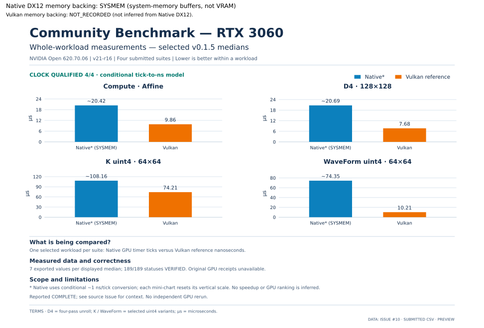
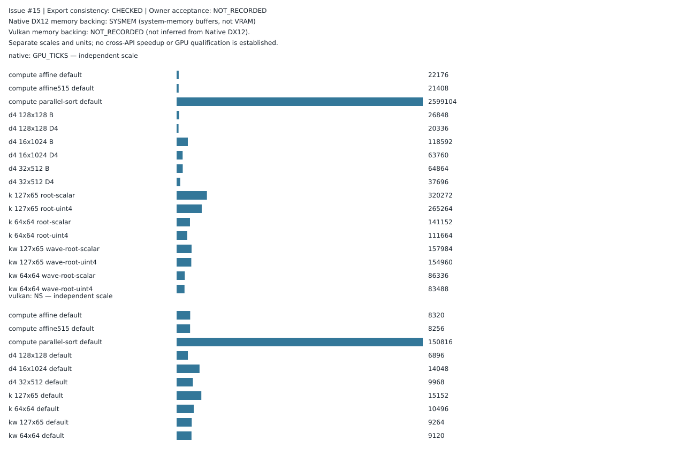
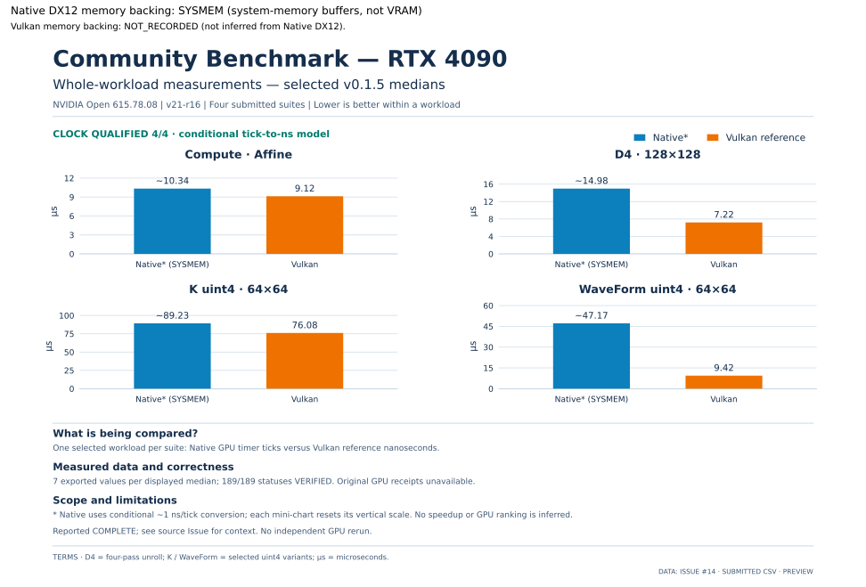

<!-- ndx12:aggregate:v0.1.5:start -->
# Community benchmark v0.1.5 — submitted measurement data

**Native DX12 memory backing: SYSMEM (system-memory buffers, not VRAM)**, from the release-artifact evidence below. Vulkan memory backing: **NOT_RECORDED**; do not infer it from Native DX12.

4 public submissions checked for **v0.1.5 / v21-r16**. 3 have matching GPU/release exports. Values are extracted from public share archives; this is not an independent GPU rerun or blanket acceptance.

## Submission overview

| GPU | Exported process status | GPU tick-to-ns model | Important limitation |
| --- | --- | --- | --- |
| [RTX 3060](v0.1.5-submitted-data.md#rtx-3060--issue-10) | 189/189 VERIFIED | QUALIFIED, 4/4 suites | Reported COMPLETE; original GPU receipts unavailable |
| [RTX 3090 (claimed)](https://github.com/GoblinFlash/Native-DX12-Linux/issues/11) | No imported values | NOT_RECORDED | GPU_MISMATCH: archive reports RTX 3060 |
| [RTX 4060](v0.1.5-submitted-data.md#rtx-4060--issue-15) | 189/189 VERIFIED | QUALIFIED, 4/4 suites | Reported COMPLETE; original GPU receipts unavailable |
| [RTX 4090](v0.1.5-submitted-data.md#rtx-4090--issue-14) | 189/189 VERIFIED | QUALIFIED, 4/4 suites | Reported COMPLETE; original GPU receipts unavailable |

## How to read these numbers

- Native values are GPU timer ticks; Vulkan values are nanoseconds. Charts use the same conditional ~1 ns/tick presentation as v0.1.4 only for complete exports with all four reported clock checks QUALIFIED and envelopes containing 1 ns/tick. Other cases retain separate raw-unit panels.
- Each table value is the median of exported process values. D4, K and WaveForm use medians of process medians; the full-work timing includes synchronization, not isolated shader timing.
- The same four workload selections, panel layout, fonts, blue/orange series and explanations come from the published v0.1.4 chart templates. Every variant remains in the tables.
- No cross-GPU ranking or speedup is calculated. Reported clock qualification is conditional and does not prove actual per-dispatch clocks, absence of contention or GPU receipt authenticity.

## RTX 3060 — [Issue #10](https://github.com/GoblinFlash/Native-DX12-Linux/issues/10)

GPU PCI ID: `10de:2503` · Driver: `620.70.06` · Export: **189/189 VERIFIED** · Clock model: **QUALIFIED, 4/4 suites**.

**Native DX12 memory backing: SYSMEM (system-memory buffers, not VRAM)**. [Release evidence](https://github.com/GoblinFlash/Native-DX12-Linux/blob/v0.1.5/NDX12_GPU_Benchmark/README.md#L113).

*Selected medians from the four suites; all variants appear in the tables below.*

### Compute suite

| Workload / native variant | Native SYSMEM median (GPU ticks) | Vulkan median (ns) |
| --- | ---: | ---: |
| Affine | 20,416 | 9,856 |
| Affine N515 | 32,416 | 9,664 |
| ParallelSort N515 | 2,610,240 | 182,336 |

### Test 1 — D4

| Workload / native variant | Native SYSMEM median (GPU ticks) | Vulkan median (ns) |
| --- | ---: | ---: |
| 128×128 Original | 27,568 | 7,680 |
| 128×128 D4 | 20,688 | 7,680 |
| 32×512 Original | 67,408 | 10,976 |
| 32×512 D4 | 40,208 | 10,976 |
| 16×1024 Original | 121,104 | 15,840 |
| 16×1024 D4 | 66,544 | 15,840 |

### Test 2 — K

| Workload / native variant | Native SYSMEM median (GPU ticks) | Vulkan median (ns) |
| --- | ---: | ---: |
| 64×64 scalar | 117,584 | 74,208 |
| 64×64 uint4 | 108,160 | 74,208 |
| 127×65 scalar | 240,496 | 143,552 |
| 127×65 uint4 | 211,920 | 143,552 |

### Test 3 — K WaveForm

| Workload / native variant | Native SYSMEM median (GPU ticks) | Vulkan median (ns) |
| --- | ---: | ---: |
| 64×64 scalar | 77,008 | 10,208 |
| 64×64 uint4 | 74,352 | 10,208 |
| 127×65 scalar | 113,264 | 10,496 |
| 127×65 uint4 | 110,160 | 10,496 |

Submitted archive SHA-256: `f424668009885acad705fc0baf2fd40bac7dd9154813926001e2360ad604d6ff`.

[Full sanitized per-Issue data](NVIDIA/RTX_3060/v0.1.5/issue-10/README.md).

## RTX 3090 — [Issue #11](https://github.com/GoblinFlash/Native-DX12-Linux/issues/11)

**Manual review — GPU_MISMATCH: archive reports RTX 3060. No measurements or chart are assigned to this claimed GPU.**

Submitted archive SHA-256: `f424668009885acad705fc0baf2fd40bac7dd9154813926001e2360ad604d6ff`.

This archive is identical to Issue #10: it identifies **RTX 3060**, PCI `10de:2503`. It supplies no results for the claimed GPU.

The reporter must provide a genuine share-results bundle for **v0.1.5** from the claimed **RTX 3090**, with matching GPU model/PCI ID, release identity and driver in `run.json` and the corresponding exported tables. Renaming the archive or changing the Issue declaration does not correct the measurements. A maintainer must reconcile the corrected submission before importing it.

## RTX 4060 — [Issue #15](https://github.com/GoblinFlash/Native-DX12-Linux/issues/15)

GPU PCI ID: `10de:2882` · Driver: `615.78.08` · Export: **189/189 VERIFIED** · Clock model: **QUALIFIED, 4/4 suites**.

**Native DX12 memory backing: SYSMEM (system-memory buffers, not VRAM)**. [Release evidence](https://github.com/GoblinFlash/Native-DX12-Linux/blob/v0.1.5/NDX12_GPU_Benchmark/README.md#L113).

*Selected medians from the four suites; all variants appear in the tables below.*

### Compute suite

| Workload / native variant | Native SYSMEM median (GPU ticks) | Vulkan median (ns) |
| --- | ---: | ---: |
| Affine | 22,176 | 8,320 |
| Affine N515 | 21,408 | 8,256 |
| ParallelSort N515 | 2,599,104 | 150,816 |

### Test 1 — D4

| Workload / native variant | Native SYSMEM median (GPU ticks) | Vulkan median (ns) |
| --- | ---: | ---: |
| 128×128 Original | 26,848 | 6,896 |
| 128×128 D4 | 20,336 | 6,896 |
| 32×512 Original | 64,864 | 9,968 |
| 32×512 D4 | 37,696 | 9,968 |
| 16×1024 Original | 118,592 | 14,048 |
| 16×1024 D4 | 63,760 | 14,048 |

### Test 2 — K

| Workload / native variant | Native SYSMEM median (GPU ticks) | Vulkan median (ns) |
| --- | ---: | ---: |
| 64×64 scalar | 141,152 | 10,496 |
| 64×64 uint4 | 111,664 | 10,496 |
| 127×65 scalar | 320,272 | 15,152 |
| 127×65 uint4 | 265,264 | 15,152 |

### Test 3 — K WaveForm

| Workload / native variant | Native SYSMEM median (GPU ticks) | Vulkan median (ns) |
| --- | ---: | ---: |
| 64×64 scalar | 86,336 | 9,120 |
| 64×64 uint4 | 83,488 | 9,120 |
| 127×65 scalar | 157,984 | 9,264 |
| 127×65 uint4 | 154,960 | 9,264 |

Submitted archive SHA-256: `1f353838bc9a83488a261f9f31adaa4baf33058fb3ffd7e0a269ef5b1e7ce817`.

[Full sanitized per-Issue data](NVIDIA/RTX_4060/v0.1.5/issue-15/README.md).

## RTX 4090 — [Issue #14](https://github.com/GoblinFlash/Native-DX12-Linux/issues/14)

GPU PCI ID: `10de:2684` · Driver: `615.78.08` · Export: **189/189 VERIFIED** · Clock model: **QUALIFIED, 4/4 suites**.

**Native DX12 memory backing: SYSMEM (system-memory buffers, not VRAM)**. [Release evidence](https://github.com/GoblinFlash/Native-DX12-Linux/blob/v0.1.5/NDX12_GPU_Benchmark/README.md#L113).

*Selected medians from the four suites; all variants appear in the tables below.*

### Compute suite

| Workload / native variant | Native SYSMEM median (GPU ticks) | Vulkan median (ns) |
| --- | ---: | ---: |
| Affine | 10,336 | 9,120 |
| Affine N515 | 9,984 | 8,800 |
| ParallelSort N515 | 2,158,528 | 150,176 |

### Test 1 — D4

| Workload / native variant | Native SYSMEM median (GPU ticks) | Vulkan median (ns) |
| --- | ---: | ---: |
| 128×128 Original | 21,104 | 7,216 |
| 128×128 D4 | 14,976 | 7,216 |
| 32×512 Original | 56,448 | 10,272 |
| 32×512 D4 | 32,128 | 10,272 |
| 16×1024 Original | 104,496 | 14,560 |
| 16×1024 D4 | 55,520 | 14,560 |

### Test 2 — K

| Workload / native variant | Native SYSMEM median (GPU ticks) | Vulkan median (ns) |
| --- | ---: | ---: |
| 64×64 scalar | 92,160 | 76,080 |
| 64×64 uint4 | 89,232 | 76,080 |
| 127×65 scalar | 165,856 | 148,576 |
| 127×65 uint4 | 163,856 | 148,576 |

### Test 3 — K WaveForm

| Workload / native variant | Native SYSMEM median (GPU ticks) | Vulkan median (ns) |
| --- | ---: | ---: |
| 64×64 scalar | 49,744 | 9,424 |
| 64×64 uint4 | 47,168 | 9,424 |
| 127×65 scalar | 57,680 | 9,632 |
| 127×65 uint4 | 55,136 | 9,632 |

Submitted archive SHA-256: `1c97e29fe0bea9b6df0c10fa8836283d98c118a478482bcffe4697d3ef8fe40d`.

[Full sanitized per-Issue data](NVIDIA/RTX_4090/v0.1.5/issue-14/README.md).
<!-- ndx12:aggregate:v0.1.5:end -->
