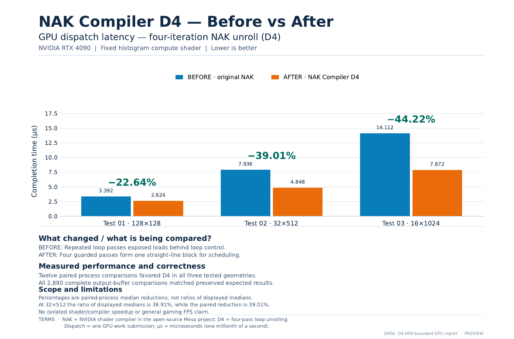
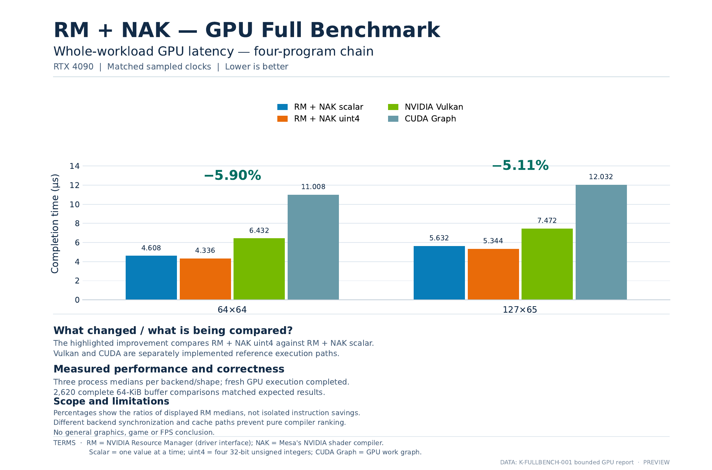

# NVIDIA — Experiment Results

**Test hardware:** GeForce RTX 4090 (Ada Lovelace).

These are recorded GPU compute experiments. The two performance charts compare a version before a specific change with a version after it. Both versions were checked for correct output.

## Test 1 — Faster histogram calculations

**What does it do?** The GPU counts how often each number from 0 to 255 appears in 16,384 generated values, similar to counting brightness levels in an image.

**What changed?** Four repeated operations were grouped together in the experimental NVIDIA shader compiler path.

| Arrangement of the same 16,384 values | Before | After | Less time |
| --- | ---: | ---: | ---: |
| 128×128 | 3.392 µs | 2.624 µs | 22.64% |
| 32×512 | 7.936 µs | 4.848 µs | 39.01% |
| 16×1024 | 14.112 µs | 7.872 µs | 44.22% |

The arrangements describe how the generated values were organized for the test. They are not display resolutions. The recorded experiment passed 2,880 full output-buffer comparisons.

## Test 2 — Four GPU programs working together

**What does it do?** Four connected GPU programs prepare generated numbers, count them and combine the counts into a final result.

**What changed?** The final program reads four neighboring counts together instead of reading them one at a time.

| Generated input | Before | After | Less time for all four programs |
| --- | ---: | ---: | ---: |
| 64×64 (4,096 values) | 4.608 µs | 4.336 µs | 5.90% |
| 127×65 (8,255 values) | 5.632 µs | 5.344 µs | 5.11% |

This measures the complete four-program GPU sequence, not just the changed final program. The recorded experiment passed 2,620 full output-buffer comparisons. Vulkan and CUDA appear on the chart as separate reference measurements, not a universal speed ranking.

## Other recorded RTX 4090 execution tests

| Test | What was checked | Result in the recorded run |
| --- | --- | --- |
| Affine u32 | A small numerical calculation and its complete output | GPU work completed; output matched the independent expected result |
| FidelityFX ParallelSort | Sorting 515 values across 40 GPU dispatches | GPU work completed; the final sorting and permutation checks passed |

These two execution checks do not include a qualified performance comparison.

## Reproducing the results

Work is underway to make GPU benchmarks easier to run on another Linux machine. The public source release does not yet contain a ready-to-run version of these exact benchmark campaigns. The underlying development evidence for the charts is retained privately.

For the recorded hardware, methods, source identities and limitations, see [measurement and validation details](../../docs/validation.md).

[All experiment results](../README.md) · [Project home](../../README.md)
