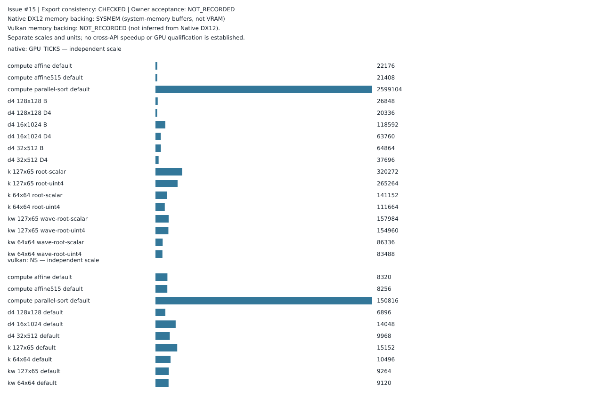

# Experiment Results

Recorded GPU experiments, CPU-side development checks and community benchmark submissions. Each result is tied to its hardware, benchmark revision and measurement method.

## Community Benchmark Data — v0.1.5

<!-- ndx12-community-intake:start -->
- [NVIDIA RTX 4060 / v0.1.5 / Issue #15](Community/NVIDIA/RTX_4060/v0.1.5/issue-15/README.md) — export consistency **CHECKED**; owner acceptance **NOT_RECORDED** (`DATA_READY`). 
<!-- ndx12-community-intake:end -->

Export consistency and owner acceptance are separate: intake checks exported data but does not record owner acceptance or infer it from a merged PR. Export consistency does not prove GPU execution or permit Native-versus-Vulkan rankings.

## Community Benchmark Data — v0.1.4

Four NVIDIA GPU submissions were received for benchmark **v0.1.4 / v21-r14**. Their exported CSV and JSON files have been inspected and the workload medians recalculated.

| GPU | Exported process status | GPU tick-to-ns model | Important limitation |
| --- | --- | --- | --- |
| [RTX 3060](Community/v0.1.4-submitted-data.md#rtx-3060--issue-4) | 189/189 VERIFIED | QUALIFIED, 4/4 suites | Model clarified; maintainer acceptance pending |
| [RTX 3060 Ti](Community/v0.1.4-submitted-data.md#rtx-3060-ti--issue-3) | 189/189 VERIFIED | QUALIFIED, 4/4 suites | Background ONNX GPU activity |
| [RTX 3090](Community/v0.1.4-submitted-data.md#rtx-3090--issue-5) | 189/189 VERIFIED | **NOT_QUALIFIED**, 4/4 suites | Native-versus-Vulkan percentage comparisons invalid |
| [RTX 4060 Laptop](Community/v0.1.4-submitted-data.md#rtx-4060-laptop-gpu--issue-2) | 189/189 VERIFIED | QUALIFIED, 4/4 suites | Laptop-specific submission |

**[View charts and extracted benchmark measurements](Community/v0.1.4-submitted-data.md)** — four GPU-specific charts and complete median tables for all four suites, with source archives and caveats.

These are **reported export statuses**, not four independently repeated GPU qualifications. The public share archives do not include original per-process GPU receipts. No overall performance ranking is implied.

## Results by development area

1. **[NVIDIA experiments](NVIDIA/README.md)** — RTX 4090 recorded GPU execution, optimization experiments and correctness checks.
2. **[Community benchmark submissions](Community/README.md)** — per-GPU folders, review status, issue links and submitted measurements.
3. **[AMD](AMD/README.md)** — RadeonSI adapter checks performed on the CPU; no qualified AMD GPU benchmarks here.
4. **[Intel](Intel/README.md)** — early Iris Xe development and test programs; no qualified Intel GPU benchmark results here.

Results from different GPU models, drivers, clock domains or workloads must not be combined into a universal performance comparison.

[Back to the project overview](../README.md)
