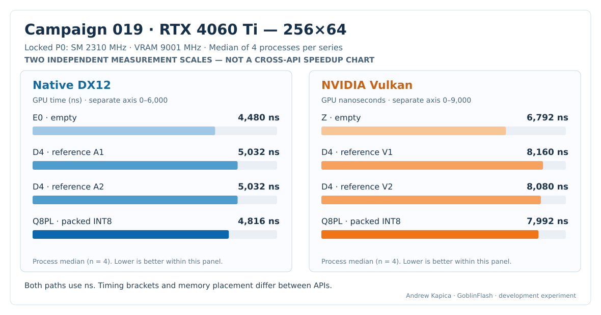
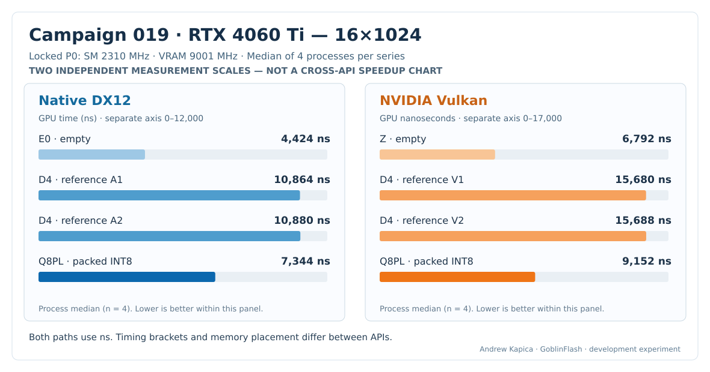

# Campaign 019 — Locked-clock GPU measurements on RTX 4060 Ti

15 November 2026 · development experiment · saved GPU evidence checked by campaign author · independent review pending

## Research question

Can Native DX12 and NVIDIA Vulkan workloads be measured reproducibly with the
GPU held at a documented power state? How do the empty, D4 reference and packed
INT8 (Q8PL) histogram variants behave within each measurement path?

Campaign 018 used dynamic clocks. Its post-process checks found the GPU in P8
after Native runs (210 MHz core / 405 MHz memory), making its previous
Native-versus-Vulkan ranking unreliable. Campaign 019 repeats the controlled
workload set at locked clocks. **The experiment tests clock-state control and
records independent timing metrics; it does not prove a Vulkan-translation
overhead reduction.**

## Workload and method

- **Hardware:** NVIDIA GeForce RTX 4060 Ti (Ada), NVIDIA Open driver
  `620.70.06`; Vulkan API `1.4.357`.
- **Compute:** 16,384 input samples, 256-bin histogram, with two mappings:
  `256×64` and `16×1024`.
- **Variants:** empty/reference (E0/Z), D4 reference (A1/A2 and V1/V2), and
  Q8PL packed INT8 (L/W). The recorded outputs were bit-exact across the
  respective active histogram arms; empty controls retained zero output.
- **Clock control:** locked 2310 MHz SM/core and 9001 MHz memory. All 1,717
  in-run telemetry samples, taken at approximately 100 ms intervals, reported
  P0 / 2310 / 9001 MHz. Before/after checks recorded the same values. Clocks
  were reset after the campaign.
- **Repetitions:** 67/67 GPU processes closed (three initial probes and 64
  scheduled process runs). Each reported series median uses four processes;
  four rounds were retained. No kernel records were added during the recorded
  run; resource-manager allocation/free totals were 396/396.
- **Evidence level:** GPU execution and output checks are recorded in saved
  campaign artifacts and were replay-verified by the campaign author. No
  separate independent hardware rerun or reviewer qualification is claimed.

## Results — separate units and axes

The charts have **independent horizontal scales**. A Native GPU tick is **not
established to equal one nanosecond**. Never compare bar lengths between the
Native and Vulkan panels.

### `256×64`

### `16×1024`

| Variant | 256×64 Native (ticks) | 256×64 Vulkan (ns) | 16×1024 Native (ticks) | 16×1024 Vulkan (ns) |
| --- | ---: | ---: | ---: | ---: |
| Empty E0 / Z | 4,480 | 6,792 | 4,424 | 6,792 |
| D4 A1 / V1 | 5,032 | 8,160 | 10,864 | 15,680 |
| D4 A2 / V2 | 5,032 | 8,080 | 10,880 | 15,688 |
| **Q8PL L / W** | **4,816** | **7,992** | **7,344** | **9,152** |

Values are medians of **four process-level observations per series**. The
two D4 variants are kept separate rather than merging their medians. The
[summary CSV](data/campaign019-rtx4060ti-locked.csv) additionally records
each series' observed process-level range and its four median inputs; it is
derived from retained private GPU receipts, not a replacement for them.

Within the **Native** path, Q8PL recorded 216 fewer ticks than D4 A1 on
`256×64` (5,032 → 4,816) and 3,520 fewer ticks on `16×1024`
(10,864 → 7,344). Within the **Vulkan** path, the corresponding V1-to-W
medians changed from 8,160 to 7,992 ns and from 15,680 to 9,152 ns.
These are within-path descriptive differences, not cross-API speedups.
The campaign's recorded measurement-noise floor was about 1.77%, with a
3.55% decision threshold; small changes should be treated cautiously.

## What the experiment establishes

1. A controlled, repeatable **P0 clock-state observation** was recorded
   throughout the bounded campaign. Dynamic-clock results from Campaign 018
   cannot be used as a fair Native-versus-Vulkan ranking.
2. Both the native and Vulkan paths completed the tested histogram variants,
   with matching saved histogram results and their empty controls.
3. Q8PL reduced the observed within-path metric substantially for the
   long-loop `16×1024` shape. The remaining shader, scheduling and launch
   contributions have not been isolated.

## Limits and next checks

- **Uncalibrated clocks:** Native reports GPU ticks; Vulkan reports GPU
  nanoseconds (`timestampPeriod = 1 ns` on this device). No validated
  Native tick-to-nanosecond conversion exists for this campaign.
- **Different timing boundaries:** Native includes launch-to-flush,
  wait-for-idle and memory-barrier work; Vulkan timestamps bracket the frame
  commands. Empty measurements are **not** pure shader or API overhead.
- **Different memory placement:** Native data reside in VRAM, while the
  project-defined Vulkan reference uses system memory. Equal clock readings
  do not eliminate this confounder.
- **Scope:** One RTX 4060 Ti, one NVIDIA driver version, one locked clock
  configuration and two workload shapes. Telemetry at 100 ms intervals
  cannot exclude shorter clock transients. No claim about commercial games,
  general D3D12 support or performance superiority follows.
- **Review:** Saved evidence was checked by the campaign author; independent
  review and a matching calibrated cross-API experiment remain **NOT_RUN**.

**Next question:** Can the Native timer domain be established and calibrated,
with matched timing brackets and matched GPU-memory backing, before any
quantitative Native-versus-Vulkan execution-time claim is made?

## Evidence identities

The following SHA-256 values identify saved, private campaign artifacts;
they are not public downloads or proof of independent reproduction:

| Artifact | SHA-256 |
| --- | --- |
| Sealed design record | `b8b366ccfe622c0008ab04bc247c6feba093baf6610ea6d6a0a8971fe8425aa8` |
| Sealed input manifest | `4dfdb229f1cd50150edcba7fe15e167e266cfd7648f2fb6754d2ebbef64623b1` |
| Fetched GPU capture archive | `ab09820110c0b5883ff812edd90631ba00c0dcfb0aa1499d6aa20966410d1b84` |
| Checked histogram output | `767b409a9fd6ca2c857376e155e5455d9a6a933146d65b99c9f0580bc39bd043` |

**Andrew Kapica — GoblinFlash.** Development experiment; not a released
community benchmark result.
