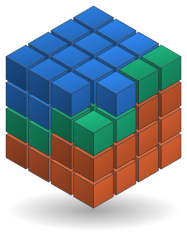
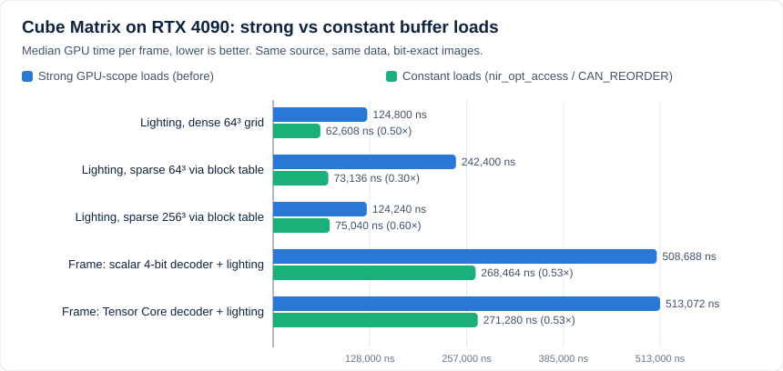

#  Cube Matrix — compressed 3D light grid on the native D3D12 path

17–20 November 2026 · part of Native DX12 Linux (NDX12) · development evidence · not a released benchmark result

## What the experiment asks

Real-time lighting often stores precomputed light in a 3D grid: the scene is cut into cells, and every cell keeps the
light that reaches it (colour, direct light, shadow, sky visibility). A full-resolution grid is large. Cube Matrix asks:

1. How small can such a grid get when cells are stored in blocks and reconstructed on the GPU?
2. Can the reconstruction run on **Tensor Cores** (`IMMA` / `HMMA` instructions) emitted by the native compiler path
   (DXIL → SPIR-V → NIR → NAK), not through Vulkan or CUDA?
3. Does a smaller grid make the actual lighting pass faster on a real scene, or only smaller?

The unit of storage is a **block of 4 × 4 × 4 cells** (the icon above). Empty blocks (air) are not stored.
Each block is either constant (one value) or a small matrix model with an exception list for cells the model cannot
reproduce within a fixed error bound.

## Method

- **Scene:** Sponza (Crytek Sponza via the Unity Classic Sponza remaster, CC BY 3.0, see *Licence* below).
  Real geometry and materials, 264,754 triangles. The light is computed by the project's own CPU code (sun with shadows, 32 sky
  directions, one coloured diffuse bounce with 512 rays per cell), not Unity's baked lightmaps.
  Grids of 64³ cells (51.7 cm per cell) and 256³ cells (12.9 cm).
  At 64³, 8.9 % of the cells are occupied; at 256³, 3.0 %.
- **Formats compared:**
  - a flat 8-bit grid;
  - a sparse 8-bit grid with a block table;
  - 2-, 3- and 4-bit quantised grids;
  - several Tensor Core block models (gated linear model, Walsh–Hadamard transform on int8 with exceptions,
    "Triple Mode" EMPTY / CONSTANT / MATRIX block table);
  - a direction-aware grid (D8, 8 bytes per cell: indirect colour, sun visibility and an int8 light direction).
- **Correctness first:** every GPU result is compared byte for byte with an independent CPU reference (the decoded
  grid and the lit 1920 × 1080 image). Each campaign carries negative controls: one changed input byte or a stale frame
  must change exactly the predicted number of output words. Timing is only reported for verified rows.
- **Timing:** median raw GPU timer ticks over 3 processes × 14 frames (frames 1–2 not counted), clocks locked. Ticks are
  **not converted to nanoseconds**: the tick rate was not calibrated.
- **Hardware:**
  - early stages: GeForce RTX 2060 SUPER (SM75);
  - most stages: RTX 4060 Ti (SM89, locked at 2310 / 9001 MHz);
  - final stages: RTX 4090 (SM89, locked at 2520 / 10501 MHz).

  All runs used NVIDIA Open driver 620.70.06 on Linux.
- **Rule for real scenes:** occupied and empty cells are reported separately, and every compressed format is compared
  with a fair sparse-grid control that pays for its own index. Results are not inflated by the 91 % of the cube that is
  air.

## Main results

### 1. Tensor Cores work on the native path

The pinned NAK compiler emits `imma.m16n8k32.i8.i8` from the project's SPIR-V. Tensor Core decoders produce results
**bit-identical** to the CPU model on the RTX 4060 Ti and RTX 4090. Against a scalar reconstruction of the *same*
model, the Tensor Core version was 3.0–3.1× faster on Sponza.

### 2. Sizes on Sponza (64³)

The two tables use different versions of the grid data and are not comparable with each other.

**Sun light + material, 14 channels per cell, occupied part only:**

| Format | Bytes | Maximum error (levels 0–255) |
| --- | ---: | --- |
| Sparse 8-bit grid with index (lossless control) | 375,672 | 0 |
| Gated Tensor Core model + exceptions | 313,752 | 50 |
| Light dictionary + 8-bit material | 248,962 | 0 |
| Light dictionary + 4-bit material | 155,678 | 8 |

**Coloured indirect light, 8 bytes per cell, whole grid (same data for every row):**

| Format | Bytes | Maximum / mean error |
| --- | ---: | --- |
| 3-bit quantised sparse grid | 101,652 | 18 / 6.46 |
| Walsh–Hadamard, Triple Mode, exceptions above 18 | 85,152 | 18 / 2.41 |
| 2-bit quantised sparse grid | 84,160 | 42 / 12.93 |
| Walsh–Hadamard, Triple Mode, exceptions above 50 | 58,976 | 50 / 4.86 |

- **Sun light + material:** the simple dictionary beats the Tensor Core model on size.
- **Coloured indirect light:** the Hadamard model with exceptions wins on size and mean error.
  - Against 3-bit at the same maximum error (18), it is 16 % smaller.
  - Against 2-bit, it is 30 % smaller, at a maximum error of 50 instead of 42.
  - In both pairs, the mean error is about 2.7× lower.

### 3. The fair-control lesson: a smaller grid is not a faster frame

- **Decoder alone.** The Hadamard decoder was 1.63× slower than a 2-bit reader written in the same thread shape
  (one group per block, empty blocks skipped).
  - An earlier comparison against a reader in a weaker shape had shown the opposite (0.93×). It was withdrawn after the fair
    control (stage 21).
  - The reader's shape alone changed its time by 1.75×.
- **Decoder in front of the lighting pass.** On Sponza (1920 × 1080, G-buffer from the scene camera), decoding before
  lighting added 6.6 % (2-bit), 6.7 % (3-bit), 8.1 % and 9.0 % (Hadamard X50 / X18, Tensor Core) to the frame. The
  whole scene fits in L2, so the smaller container does not shorten the lighting pass.
- **Direction-aware grid D8.** It improves the image from 24.4 to 28.0 dB PSNR (camera 1) at the same 8 bytes per cell.
  After optimisation it costs +19 % over an equally optimised grid without direction.
- **Multi-frame pipeline with two volume buffers on the GPU.** The decoder of frame k overlaps the lighting of frame
  k − 1 (4 frames, every image verified, stale-frame negative control). It saved only 0.4–0.5 % of the frame, with no
  Tensor Core advantage.

### 4. The compiler finding: strong loads

A review of the NAK instruction listing pointed at the load kind. NAK emits `ld.global.constant` only when a NIR load
carries `ACCESS_CAN_REORDER`; otherwise every buffer load is `ld.global.strong.gpu`. NVIDIA's Vulkan driver path in
Mesa (NVK) sets that flag by running `nir_opt_access`; the NDX12 adapter did not. **Every timing above was therefore measured
with strong GPU-scope loads.**

Data: [`data/cube-matrix-constant-loads.csv`](data/cube-matrix-constant-loads.csv).

With constant loads (same source, same data, images still bit-exact):
- the lighting pass is 2.0× faster on the dense 64³ grid and 3.3× on the sparse 64³ grid with a block table;
- the sparse 256³ grid is 1.66× faster;
- the full decoder → lighting frame is about 1.9× faster for both decoders;
- the unexplained 2× penalty of the block table at 64³ disappeared (1.94× → 1.09×);
- sparse 256³ with the block table is now within 9 % of dense 64³.

The Tensor Core and scalar 4-bit decoders remain about equal (1.01×).

**Constant loads across dispatches.** The decoder writes a volume and the next dispatch of the same frame reads it with
constant loads. This was tested with one volume buffer overwritten with *different* data every frame, which is the worst
case for a stale cache. All frames were bit-exact, and a stale-frame negative was rejected. The runtime invalidates the
data and constant caches at each barrier.

The adapter change has since been applied to the project's normal compiler adapter. In the benchmark package's small
programs it was neutral: new / old time 0.97–1.01, all outputs verified.

### 5. Scaling to 256³

- The dense 256³ volume (128 MiB) does not fit the runtime's 128 MiB pool. A sparse pool of 23,424 occupied
  blocks (12 MB) with a block table is used instead.
- Lighting at 256³ through the table is bit-exact. PSNR against the reference: 27.75 dB for D8O, 27.77 dB for Hadamard
  X50 and 27.40 dB for 4-bit.
- With strong loads, the Tensor Core decoder was 1.85× slower than the scalar 4-bit decoder, and the frame 1.057× slower.

## Conclusion

- **Tensor Core reconstruction works natively and exactly.** For coloured indirect light it gives the smallest container
  at the same maximum error. For sun light + material, a plain dictionary is smaller.
- **On this scene it does not make the frame faster.** The data fits in L2, and the lighting pass dominates the frame.
- **The largest single speed-up came from the compiler, not from the format.** Marking read-only buffer loads as
  reorderable halved the frame. The fix is now in the adapter.
- **Two earlier claims were withdrawn:**
  - "Tensor Cores 3–7× faster": it came from a slow store pattern in the scalar baseline;
  - "Hadamard faster than 2-bit": it came from an unfair reader shape.

  The original records are kept.

## Limits

- One scene (Sponza), one camera set, static lights for most stages. Moving-light grid updates and cold-cache L2 were
  measured only in bounded stages.
- **Raw GPU ticks, uncalibrated.** No millisecond claims. Clocks were locked; observed clocks during each dispatch were
  not separately established.
- **SM89 is the main target.** SM75 was used only for early stages, and SM86 / SM120 were not run. The Tensor Core
  programs are SM89 builds.
- **No Vulkan comparison** for these programs. NVK is cited as the source of the compiler pass, not as a measured
  baseline.
- Hardware counters (L1 / L2 hit rates) are not available on the native RM path. Cache explanations are labelled
  inferred.
- Code review for publication (CodeRabbit) and licence / NOTICE closure are open.

## Licence of the scene

The Sponza model is © 2010 Frank Meinl, Crytek, licensed under
[CC BY 3.0](https://creativecommons.org/licenses/by/3.0/), obtained through the Unity Classic Sponza repository. The
grids, light values and images in this experiment are **adaptations**: voxelised, with light computed in this project. They are
not the original work.

## Evidence identities

Campaign archives (SHA-256 of the retained private captures; fingerprints, not public downloads):

| Campaign | What it ran | Archive SHA-256 |
| --- | --- | --- |
| tc-060 | 256³ sparse pool, RTX 4090 | `3382d1a2383d3a5e32d4c8294bf1a3d587cbc2678666de41640144be5a7edd4b` |
| tc-061 | lighting with constant loads, RTX 4090 | `60f86201c7dd99d269d1bbbb186d71c3a00b39338a479da86e3f6247db3c1b31` |
| tc-062 | decoders with constant loads, RTX 4090 | `34d5be513e50d5c0486c1dcd027f1e8489cc59d9141836f90faf27de5eb61743` |
| tc-063 | decoder → lighting pipeline, constant loads | `d1c2016b2003587483514bd37f33f0d160971c480ea9097533755d2d92bf71de` |

Third-party implementation code: none. The programs call Mesa / NAK as pinned dependencies.

**AI Disclosure:** Core architecture, mathematical concepts, and R&D direction by Andrew Kapica (GoblinFlash). Low-level NAK/IMMA shader implementation and benchmark harnesses built with AI assistance (Claude Code, ChatGPT Codex) under strict hardware verification: locked-clock GPU runs, negative fault-injection tests, and byte-for-byte CPU oracle matching.
