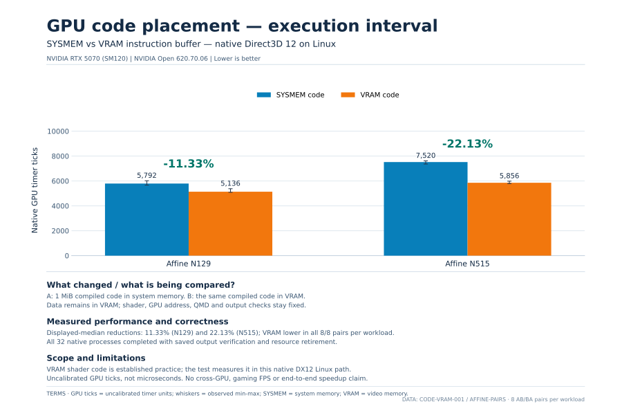
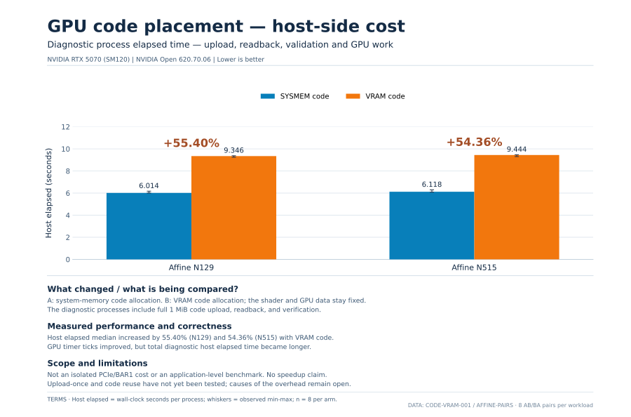

# Experiments — Native DX12 Linux

This folder documents ongoing development experiments, including why a change was
tried, how it was measured, what actually happened, and what remains unproven.
It is separate from the [community benchmark submissions](../Experiment%20Results/README.md).

## Current experiment: GPU instruction memory placement (SYSMEM vs VRAM)

12 November 2026 · RTX 5070 · controlled A/B completed · saved evidence checked

**Research question:** Does placing the GPU's instruction buffer in VRAM instead
of system memory reduce the native execution interval, and what does it cost on
the CPU/host side?

**Context:** Keeping executable shader code in VRAM is a known GPU-driver
practice. This experiment tests that choice **inside this project's native
Direct3D 12 execution path on Linux**, without Vulkan/VKD3D translation.
It is an investigation of this implementation's behavior and costs, not a
claim to have invented GPU code placement in VRAM.

**Short answer:** GPU timer ticks decreased in these two workloads, but total
host elapsed time increased. This is a trade-off, not an end-to-end speedup.

The long-term goal is to improve the experimental native Linux Direct3D 12
compute path while keeping output correctness, resource ownership and
completion checks intact. This test changes the memory profile of an already
compiled program; it does not change the shader instructions.

### Existing practice and experiment scope

For prior art, a [2017 RADV patch proposal](https://lists.freedesktop.org/archives/mesa-dev/2017-March/147619.html)
already discussed moving executable shaders from GTT to VRAM to reduce
instruction-fetch latency. In later Mesa source, the
[RADV shader arena](https://chromium.googlesource.com/external/gitlab.freedesktop.org/mesa/mesa/+/94dfe58bcbfc426e36dca162106aa35eaf92ee67/src/amd/vulkan/radv_shader.c)
requests `RADEON_DOMAIN_VRAM`. The
[NVK shader heap](https://chromium.googlesource.com/external/gitlab.freedesktop.org/mesa/mesa/+/331af5e746b48131eedaa168f37ea9b1cb5580a3/src/nouveau/vulkan/nvk_device.c)
requests `NVKMD_MEM_LOCAL` and selects CPU-mapped or queued shader uploads
according to BAR availability. That locality flag permits VRAM or GART backing;
it does not guarantee physical VRAM residency in every configuration.

Those drivers are cited as prior art, **not as the runtime path used here**.
The question here is narrower: how much does code-buffer placement affect GPU
execution and host-side work in this specific native path? The result may
guide buffer-upload and reuse design; it does not establish superiority over
existing drivers.

### What changes — and what stays fixed

| | A — SYSMEM code | B — VRAM code |
| --- | --- | --- |
| GPU instruction buffer | Separate 1 MiB allocation in system memory | Separate 1 MiB allocation in video memory |
| Data allocations | VRAM | VRAM |
| GPU virtual address | Same | Same |
| Program offset | 1,024 bytes | 1,024 bytes |
| Shader, QMD, push data, barriers, output checks | Unchanged | Unchanged |

The changed profile includes backing, cache and CPU transfer behavior. A result
cannot be attributed solely to physical placement or PCIe latency.

### Hardware and measurement

- **GPU:** NVIDIA GeForce RTX 5070 (SM120)
- **Driver:** NVIDIA Open 620.70.06; Linux kernel 7.0.0-43
- **Workloads:** Affine N129 and Affine N515; one native dispatch per process
- **Design:** eight paired A/B comparisons per workload, balancing A→B and B→A
  order (32 processes total). No additional warmup; all samples retained.
- **Requested clocks:** 2,512 MHz core and 14,001 MHz memory. Acceptance of the
  request does not prove instantaneous clocks during each dispatch.
- **Validation:** actual GPU submission and completion, full output-buffer
  readback, allocation/ownership checks and kernel-health monitoring.

### Results and charts

All **32/32 native processes** completed with verified output buffers and
resource retirement. The saved-evidence replay passed, with **zero new kernel
records** during the recorded series. In both workloads, B used fewer GPU
timer ticks in **all eight A/B pairs**.

#### GPU execution interval

Lower is better. These are **native GPU timer ticks**, not calibrated
nanoseconds or microseconds. The values are medians of eight processes per arm.

| Workload | A: SYSMEM code | B: VRAM code | Reduction in medians | Pairs with B lower |
| --- | ---: | ---: | ---: | ---: |
| Affine N129 | 5,792 ticks | 5,136 ticks | **11.33%** | 8/8 |
| Affine N515 | 7,520 ticks | 5,856 ticks | **22.13%** | 8/8 |

The median of eight *individual paired percentage reductions* was 10.74% for
N129 and 21.49% for N515. That statistic differs from the percentage reduction
between the two arm medians shown above. Neither is a cross-GPU or universal
speedup claim.

#### Host-side cost

The diagnostic variant uploads and checks the full 1 MiB instruction buffer.
Host elapsed time includes more than execution on the GPU; it is not an
isolated PCIe transfer measurement.

| Workload | A: SYSMEM code | B: VRAM code | Increase in host time |
| --- | ---: | ---: | ---: |
| Affine N129 | 6.014 s | 9.346 s | **55.40%** |
| Affine N515 | 6.118 s | 9.444 s | **54.36%** |

**Interpretation:** this familiar placement technique reduced the measured GPU
interval in this particular experimental path, on this card and these
workloads, while the entire diagnostic host step took longer. The result does
**not** establish an end-to-end application speedup or a novel GPU optimization.
How much of the extra host cost comes from BAR1 transfers, repeated readback
or other preparation remains to be isolated.

The [32 process-level records](data/code-vram-affine-rtx5070.csv) include
pair number, A/B order, raw GPU ticks, empty-bracket ticks, whole host time and
worker time. No pair or outlier was removed. Chart bars are medians; whiskers
show observed min–max ranges, not confidence intervals.

The private retained evidence has capture SHA-256
`a1afb48560aa9c302a2a97ae064e36c43d5c4ebee3e0efff9839676d46c76d6f`.
The 1,896 captured files were checked by the project-side replay. The public
CSV permits recalculation of the displayed figures but does not itself
reproduce the hardware run. Independent hardware reproduction and an
independent final experiment review have **not** been performed.

### What this does not establish

This is one GPU model, one driver and two small compute workloads. It does not
prove broader RTX performance, game compatibility, complete Direct3D 12
support, a Vulkan comparison, or a universally faster native path. Any eventual
GPU-tick reduction must be weighed against CPU-side upload/readback cost.

**Next question:** can the instruction buffer be uploaded once and reused across
dispatches, or transferred more efficiently without weakening validation? Do
larger multi-shader workloads show the same effect? These are future
experiments, not results reported here.

**Project owner:** Andrew Kapica — GoblinFlash. Implementation and experiment
automation assisted by OpenAI Codex. These are development results, not a
released benchmark package or independent hardware reproduction.
