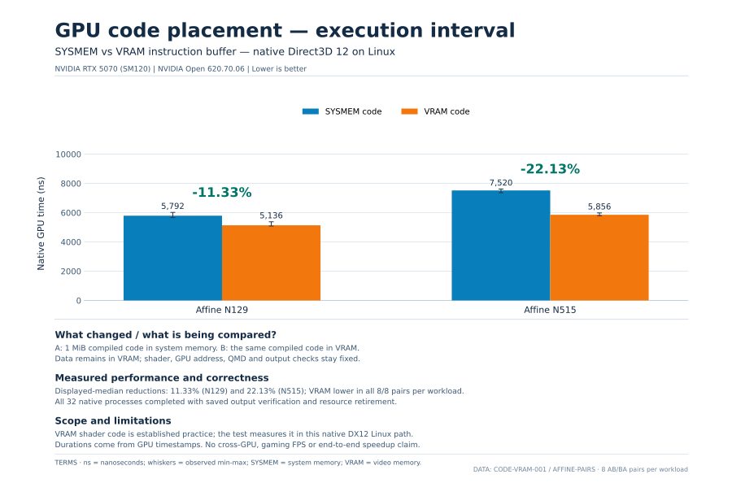
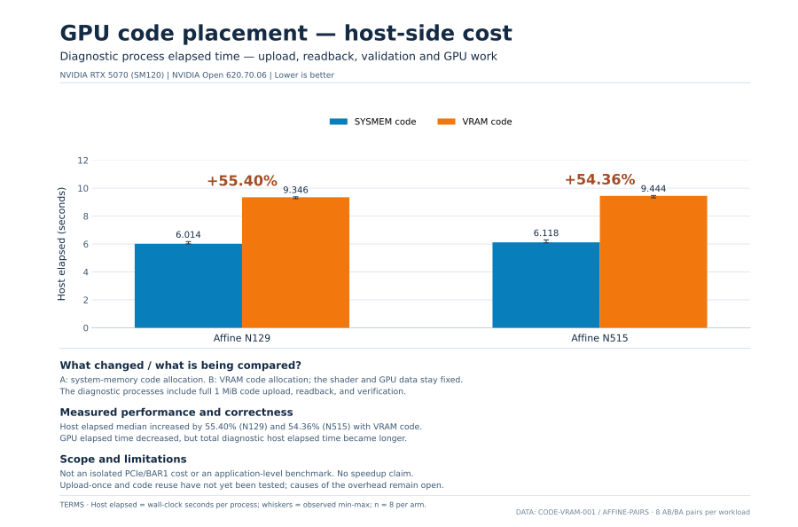

# GPU instruction memory placement — RTX 5070 pilot

12 November 2026 · recorded GPU A/B experiment · development evidence, not a release claim

This experiment examines a known GPU-driver design choice: how the placement of executable GPU code affects device-side execution time and host-side preparation cost within the project's native Linux execution path.

## Result at the recorded checkpoint

On **GeForce RTX 5070 (SM120)**, a bounded, paired pilot of two small compute workloads compared **A: executable code in SYSMEM** against **B: executable code in VRAM** (shader-visible data remained in VRAM). The VRAM-code profile had a **shorter GPU execution interval** but a **longer overall host elapsed time**. The trade-off was measured rather than assumed. Saved outputs, execution completion and resource handling were checked in the recorded series.

The experiment did not change the shader's mathematical operation. Placing GPU code in local video memory is an established practice in graphics drivers; this project does not claim to have invented it.

## Recorded GPU and host timing charts

*Device-side intervals (ns), RTX 5070. A uses SYSMEM code; B uses VRAM code. The recorded GPU intervals were lower with B in both tested workloads; eight paired A/B comparisons were recorded per workload.*

*Host elapsed time (seconds), same RTX 5070 campaign and code-placement labels. B took longer in the recorded full diagnostic host steps; these are not isolated upload or PCIe transfer measurements.*

The [published process-level CSV](data/code-vram-affine-rtx5070.csv) contains the recorded A/B order, GPU intervals and host times. The charts and CSV are historical experimental data, not a release-performance or general Vulkan comparison.

## Limitations

- One GPU model, one driver configuration and two small workloads.
- GPU timing excludes some CPU-side preparation and transfer work.
- The experiment did **not** establish a whole-application speedup, a Vulkan comparison or a generally faster native D3D12 runtime.
- Independent hardware reproduction and the final experiment review were not completed in the original report.

**Status: bounded experimental A/B, with unresolved portability and end-to-end cost.**

[Experiments overview](README.md) · [Benchmark Results](../Benchmark%20Results/README.md)

**Andrew Kapica — GoblinFlash.** Implementation and experiment automation were AI-assisted.
