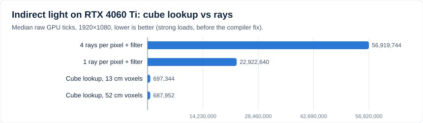
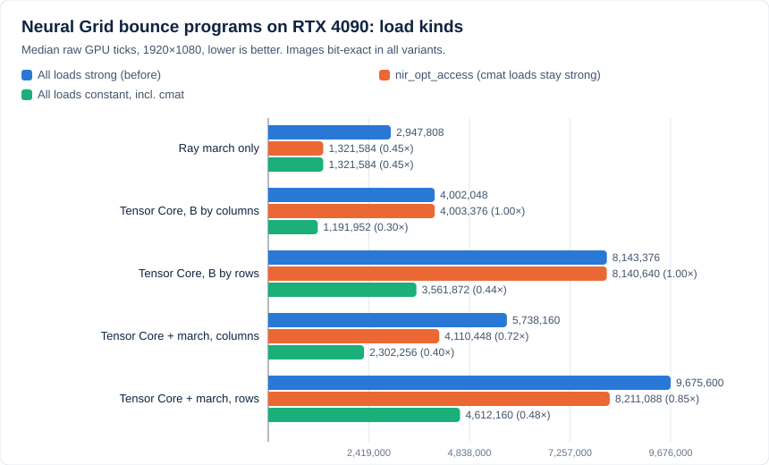

# Neural Grid & Quantization — small learned decoders and indirect light on the native D3D12 path

17–20 November 2026 · part of Native DX12 Linux (NDX12) · companion to [Cube Matrix](Cube-Matrix.md) · development evidence · not a released benchmark result

## What the experiment asks

Cube Matrix stores light in a 3D grid with hand-designed compression. Neural Grid tests the learned alternative: every
cell keeps a few int8 features, and a small neural network (a multi-layer perceptron, MLP) decodes them into the cell's
values on the GPU. Two questions:

1. **Step 1–3:** at the same memory budget, does a learned decoder beat plain quantisation (int8, int4) and a linear
   decoder (PCA)? Does it run correctly and fast through our native compiler path?
2. **Indirect light ("bounce"):** for the light that bounces off walls in Sponza, is a precomputed grid cheaper than
   tracing a few rays per pixel? Can Tensor Core work overlap the ray march?

## Step 1–3: learned decoder vs quantisation

**Method.**
- Three synthetic 64³ data sets, 8 channels per cell:
  - D1, smooth material-like data;
  - D2, non-linear data;
  - D3, independent noise.
- Variants:
  - A: 8 × FP16;
  - B: 8 × int8;
  - C: 4 int8 features + MLP 4→16→8;
  - D: 4 int8 features + PCA;
  - E: 8 × int4.

  C, D and E use the same 1 MiB.
- Training is plain NumPy, starting from the PCA decoder and finishing with quantisation-aware steps.
- Predictions were written before the run.
- PSNR is measured at voxel centres and between voxels.

**Result (PSNR dB, centres / between voxels):**

| Data | B 8×int8 | C int8 + MLP | D int8 + PCA | E 8×int4 |
| --- | --- | --- | --- | --- |
| D1 smooth | 61.90 / 67.19 | **47.60 / 46.07** | 27.39 / 27.49 | 37.27 / 41.45 |
| D2 non-linear | 59.53 / 64.81 | 32.29 / 29.88 | 20.43 / 20.55 | **34.92 / 39.66** |
| D3 noise | 59.00 / 64.28 | 18.87 / 17.89 | 14.82 / 14.89 | **34.35 / 39.20** |

- The MLP wins only on smooth data: +10.3 dB over int4 at the same size.
- On non-linear data it loses. A wider network (4→32→8) recovers +4.8 dB, but it still does not meet the preregistered
  "useful" bar of ≥ 40 dB with a maximum error ≤ 0.05.

**GPU (RTX 4060 Ti, SM89, clocks locked 2310 / 9001 MHz).**
- Seven decoders compiled by our NAK path, with no register or memory spills.
- 59 / 59 runs bit-identical to the CPU reference; the negative control changed exactly 1,000 voxels.
- One 64³ decode: 45,648 ticks for the MLP (C16) against 65,264 for FP16 (A). The order was not investigated.

**On the real scene.** The MLP fits the Sponza light grid well (57.0 dB against the lossless grid). A linear PCA decoder
with the same bytes does better (60.0 dB), and storing the three light channels at 8 bits for occupied cells alone
(78 KB) is lossless. **On Sponza, the network is not needed.**

## Indirect light: grid vs rays

**Method.**
- Sponza at 1920 × 1080 and 1280 × 720, with a coloured bounce of the sun light.
- Candidates:
  - a grid with 13 cm voxels (12 int8 values per voxel);
  - a grid with 52 cm cells;
  - 1 or 4 rays per pixel marched through an occupancy grid, plus an edge-aware filter.
- The reference image comes from many rays.
- Every GPU image is checked byte for byte against the CPU reference. Negative controls change a predicted number of
  words.

**Quality (CPU, PSNR against the reference):**
- The 13 cm grid is 7.5–8.0 dB better than the best constant ambient term.
- 1 ray per pixel with the filter is about 5.3 dB better than the grid, and 4 rays about 8 dB better.

Data: [`data/neural-grid-bounce-cost.csv`](data/neural-grid-bounce-cost.csv).

**Cost (RTX 4060 Ti, 64 / 64 runs bit-exact).**
- Reading the grid costs about 3 % of 1 ray per pixel with the filter, about 33× cheaper.
- The 13 cm and 52 cm grids cost the same: the per-pixel work dominates, not the data size.
- The verdict stayed open. The grid is far cheaper to read, but must be rebuilt when lights move.
  - Stage 3 measured a dynamic grid rebuild. The rebuild + read is still cheaper at 1080p (0.47 of the ray path) and
    costs about the same at 720p (0.96), at about 6 dB lower quality, so at 720p the faster ray path is the better choice.
  - Skipping empty blocks and replacing the division with a reciprocal made the ray march 1.73× faster.

## Tensor Cores next to the ray march

The bounce programs also test whether matrix work on Tensor Cores can run in the same program as the ray march and hide
behind it. A "zero-unpack" layout stores the B matrix by columns, so the int8 data feeds the Tensor Core without
unpacking.

Data: [`data/neural-grid-tc-loads.csv`](data/neural-grid-tc-loads.csv).

The chart compares three builds of the same programs on an RTX 4090 (clocks locked 2520 / 10501 MHz). Across the
variants, 111 / 111 rows were bit-exact and 26 / 26 negatives were as predicted.

- **All loads strong (before):** the original builds.
- **`nir_opt_access`:** the compiler pass described in [Cube Matrix](Cube-Matrix.md#4-the-compiler-finding-strong-loads).
  - The ray march alone becomes 2.2× faster (0.448).
  - The Tensor Core part does not change. Its main loads are cooperative-matrix (`cmat`) loads, which NAK creates after
    that pass, so they stay strong.
- **All loads constant:** the read-only property is also carried to the cooperative-matrix loads.
  - The Tensor Core part becomes 2.3–3.4× faster.
  - The column layout (zero-unpack) keeps its advantage: 0.335 of the row layout.
  - A general version of this rule, applied only when no store or atomic in the program targets that buffer, was
    checked on the CPU. It produced the same binaries.

**Overlap.**
- With strong loads, part of the Tensor Core time was hidden behind the march: together 12–22 % cheaper than apart
  on the RTX 4060 Ti (overlap ratio 0.78–0.88), and 0.83–0.88 on the RTX 4090 at 256.
- With constant loads, both parts are short and little remains to hide (0.94–1.0).
- In a true multi-frame pipeline (Cube Matrix stage 50), overlapping the decoder of the next frame with the lighting of
  the current frame saved 0.4–0.5 %.

## Conclusion

- A small MLP decoder **works on the native path and is exact on the GPU**, and it wins on smooth synthetic data. On the
  real Sponza light grid, linear and plain 8-bit storage are as good or better. The network is not justified there.
- For indirect light, a precomputed grid is **about 33× cheaper to read** than 1 ray per pixel with a filter, but
  **about 5 dB worse**. With moving lights it stays cheaper at 1080p only.
- The largest speed-ups again came from the **compiler load kind**: 2.2× for the march and 2.3–3.4× for the Tensor Core
  part, with identical images.

## Limits

- Synthetic data sets for steps 1–3. One real scene (Sponza) for the rest.
- **Raw GPU ticks, uncalibrated.** RTX 4060 Ti and RTX 4090 results are not compared in absolute ticks.
- The step 1–3 and bounce timings on the RTX 4060 Ti used strong loads, before the compiler fix. Only the 3B programs
  were re-measured with constant loads, on the RTX 4090.
- **No Vulkan comparison.** No hardware cache counters on the native RM path.
- Code review for publication (CodeRabbit) and licence / NOTICE closure are open.

The Sponza model is © 2010 Frank Meinl, Crytek, [CC BY 3.0](https://creativecommons.org/licenses/by/3.0/). The grids and
images here are adaptations with light computed by us.

## Evidence identities

| Campaign | What it ran | Archive SHA-256 |
| --- | --- | --- |
| ngb-4060-001 | grid vs rays, RTX 4060 Ti | `6cee10d58f10cbe20dead37c0e7656b6ea6e54f170d89d20aeace168a4d9e2b0` |
| ngb-4060-002 | faster rays, dynamic grid, TC with march | `a0c08c4d9fa4fbe65dbfcd0b51275dea66065e72f3c23c73f8f62f8bc80516b8` |
| ngb-4090-054 | load kinds, RTX 4090 | `f45bbf96832ffc6872c204d5206e410e6326c1934660636754d6bc97b085487f` |

Fingerprints of retained private captures, not public downloads. Third-party implementation code: none.
The programs use NumPy, Mesa / NAK and DXC as pinned dependencies.

**AI Disclosure:** Core architecture, mathematical concepts, and R&D direction by Andrew Kapica (GoblinFlash). Low-level NAK/IMMA shader implementation and benchmark harnesses built with AI assistance (Claude Code, ChatGPT Codex) under strict hardware verification: locked-clock GPU runs, negative fault-injection tests, and byte-for-byte CPU oracle matching.
