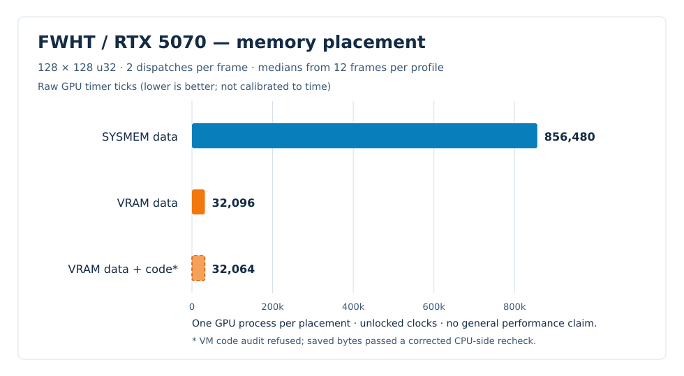
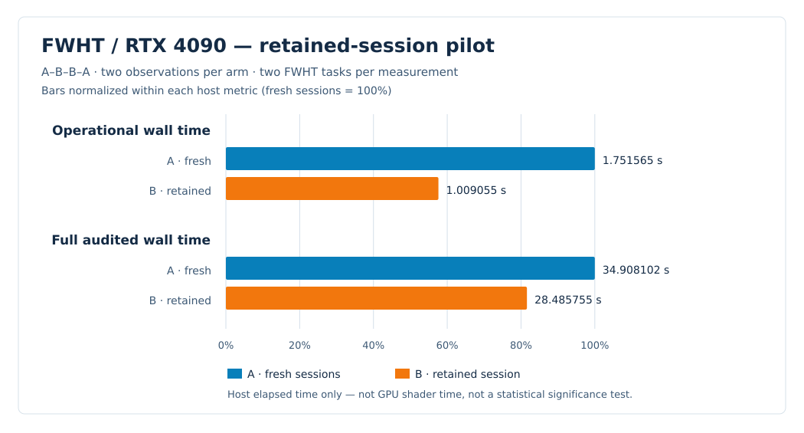

# Experiments — Native DX12 Linux

## Current experiment: Fast Walsh–Hadamard Transform (FWHT)

12 November 2026 · RTX 5070 / RTX 4090 · bounded native GPU pilots · full-benchmark integration in progress

**Research question:** Can Cache Arena safely reuse a prepared native GPU
session, shader code and VRAM allocations across multiple dependent FWHT tasks?
What does that reuse save on the host, and how does memory placement affect
the measured GPU interval?

### FWHT and Cache Arena

The **Fast Walsh–Hadamard Transform (FWHT)** is an established algorithm based
on butterfly stages of pairwise additions and subtractions. Its deterministic
output can be checked against a CPU reference, while consecutive GPU
dispatches create a real dependency through intermediate memory.

**Experiment Concept.** The proposal was to combine FWHT with
**Cache Arena**, a reusable, Rust-managed VRAM pool and persistent native GPU
session. The objective was to determine whether the same channel, code
allocation and data pool could serve multiple independent compute tasks
without losing correct synchronization, results or resource ownership.

This is why FWHT was chosen as the workload. The first native dispatch writes
intermediate values; the second must read them to finish the transform.
Running two complete transforms with different inputs through one retained
Arena tests more than buffer allocation: it checks dependent execution,
memory visibility, safe resource reuse and verified completion.

The RTX 4090 **A/B design** compares a fresh session for each FWHT task
(A) with a retained Cache Arena shared by both tasks (B). Code and data
allocations remain in VRAM; control structures remain in system memory.
The experiment targets repeated channel setup, allocation, mapping and
code-upload costs. **Cache Arena refers to software-managed resource reuse,
not a demonstrated speedup of NVIDIA's hardware L1/L2 cache or shader code.**

A separate RTX 5070 pilot examines **SYSMEM versus VRAM placement** using the
same two-dispatch FWHT shape. FWHT is also being integrated as **Test 4**
of the complete benchmark; its integrated GPU execution has not yet been
qualified.

**Current observation:** On RTX 4090, the retained Arena recorded
**42.39% lower median operational host time** across two tasks, based on
two observations per arm and checked outputs. On RTX 5070, VRAM data backing
recorded fewer **uncalibrated GPU timer ticks** than SYSMEM. These pilots
measure different effects on different GPUs, not a general performance
ranking or a Vulkan comparison.

### Workload and experiment scope

The test processes **128 × 128 unsigned 32-bit values (16,384 elements)**.
The first GPU dispatch writes an intermediate buffer; the second consumes that
buffer and completes the transform. The final output is checked against CPU
models. This two-stage dependency, rather than a CPU-inserted final result,
is the behavior under test.

Two independent pilot designs are retained:

| Pilot | Variable | Fixed / checked | Reported metric |
| --- | --- | --- | --- |
| RTX 5070 | SYSMEM or VRAM data; separate VRAM code in a third profile | Same FWHT shape, two dispatches per frame and saved full-output checks | Raw GPU timer ticks |
| RTX 4090 | Fresh sessions (A) or a retained session (B) | Same two FWHT tasks, full output checks and VRAM data/code allocations | Host elapsed time |

An instruction buffer's backing and a data buffer's backing are distinct
questions. These pilots cannot isolate every transfer, cache and driver
effect, and their timing units must not be mixed.

### Hardware and measurement

- **RTX 5070:** SM120; NVIDIA Open 620.70.06. Three memory-placement
  configurations, each in one GPU process with 14 frames. The reported
  median uses 12 frames. Clocks were not locked, and raw GPU ticks were
  **not calibrated** to nanoseconds or microseconds.
- **RTX 4090:** SM89; NVIDIA Open 620.70.06. One canary followed by an
  A–B–B–A comparison: 7 sessions, 20 dispatches and 10 FWHT tasks across
  the captures. Two observations per arm. A opens/closes a session per task;
  B retains one session across two tasks. These values are **host wall time**.
- **Verification:** Saved full buffers, expected transform results, control
  and allocation records, resource retirement and other available
  diagnostics were checked. Saved evidence does not by itself prove a new
  GPU run or a production API qualification.

### Results and charts

#### RTX 5070 — data placement and raw GPU ticks

Lower is better, but these values are **raw GPU timer ticks**. Each profile
has only one process, so the chart is a bounded observation rather than a
repeatable cross-hardware performance claim.

| Data backing | Program backing | Median raw ticks/frame | Evidence status |
| --- | --- | ---: | --- |
| SYSMEM | Control arena | 856,480 | GPU series accepted; saved output checked |
| VRAM | Control arena | 32,096 | GPU series accepted; saved output checked |
| VRAM | Separate 1 MiB VRAM code buffer | 32,064 | GPU process finished; VM audit refused; saved data rechecked on CPU |

The two accepted series show a **26.7× difference in raw tick medians**
between SYSMEM and VRAM data backing in this specific workload. That ratio
is **not** a wall-clock speedup, and the third row does not independently
establish an advantage from placing code in VRAM.

In the third profile, the on-VM audit expected 14 QMD launch records, while
the two-dispatch workload recorded 28. The corrected checker subsequently
accepted the saved data **on the CPU**; it has **not been rerun on the GPU VM**.

[RTX 5070 summary CSV](data/fwht-rtx5070-summary.csv) — derived medians,
not original per-frame receipts.

#### RTX 4090 — fresh versus retained session

The bars are normalized *separately* within each host metric to the
fresh-session baseline (A = 100%). Exact measured medians are below.

| Host metric for two tasks | A: fresh sessions | B: retained session | Difference |
| --- | ---: | ---: | ---: |
| Operational wall time | 1.751565 s | 1.009055 s | **−42.39%** |
| Full audited wall time | 34.908102 s | 28.485755 s | **−18.40%** |

This is **host-side work, not shader execution time**. The comparison has
two observations per arm in sequential A–B–B–A order; it is not a statistical
significance test. Saved phase records show **0.561522 s less median
code-upload time** in the retained arm across two tasks; setup/teardown
and audit phases also differ. These are descriptive components of a
whole-session A/B comparison, not isolated causal speedups. A smaller
code-upload strategy was **not measured**; the exact pilot artifact pins
are listed in the [detailed FWHT report](FWHT.md#tested-pilot-identities-and-evidence).

Saved output and lifetime evidence were checked and timings recalculated;
the full runtime consumer was not independently qualified. No NVIDIA Vulkan
GPU comparison was run in this pilot.

[RTX 4090 summary CSV](data/fwht-rtx4090-summary.csv) — derived host medians,
not the original per-session timing records.

### Integration into the full benchmark

FWHT is being integrated as **Test 4 of the complete benchmark**, not as
an independently released option. The working candidate is **v21-r20b**
based on an r19d development tree.

At the recorded checkpoint:

- **CPU validation:** 381 tooling tests PASS; 13 FWHT-focused tests PASS.
- **Reference:** Full buffers matched a Vulkan reference on Mesa lavapipe
  (**CPU software execution**, not NVIDIA Vulkan GPU evidence).
- **Full candidate chain:** Six-runtime build and twelve-suite validation
  had started; completion and final package were **not yet verified**.
- **Integrated FWHT candidate on an NVIDIA GPU:** **NOT_RUN**.
- **Final CodeRabbit review / release qualification:** **NOT_RUN**.

The earlier r20 CPU prototype does not qualify the newer r20b candidate.
The development pilots above are not a released community benchmark.

### Interpretation and limitations

The transform is known; what is being studied here is its behavior within
this particular experimental native Direct3D 12 execution path. The results
do **not** prove complete D3D12 support, game compatibility, GPU-wide
qualification, general performance superiority or an advantage over Vulkan.
Raw GPU ticks cannot be directly compared with host seconds.

**Next question:** Can the complete FWHT Test 4 execute reproducibly from the
final pinned benchmark package on identified NVIDIA hardware, including
submission, completion, full output and resource-lifetime verification?
A matching hardware reference and completed independent review are needed
before broader claims.

[Detailed FWHT experiment report](FWHT.md) includes the bounded methods,
failures, evidence levels and remaining checks.

### Experiment history

- [GPU instruction memory placement (SYSMEM vs VRAM) — RTX 5070](GPU-Instruction-Memory-Placement-RTX5070.md)
  — 32 process-level records across balanced A/B pairs, original GPU/host charts and summary
  CSV, hardware caveats and full original report (12 November 2026).

This is a development report, not a released benchmark result. Public tables
and charts summarize private retained evidence; they are not substitutes for
an independent hardware reproduction.
