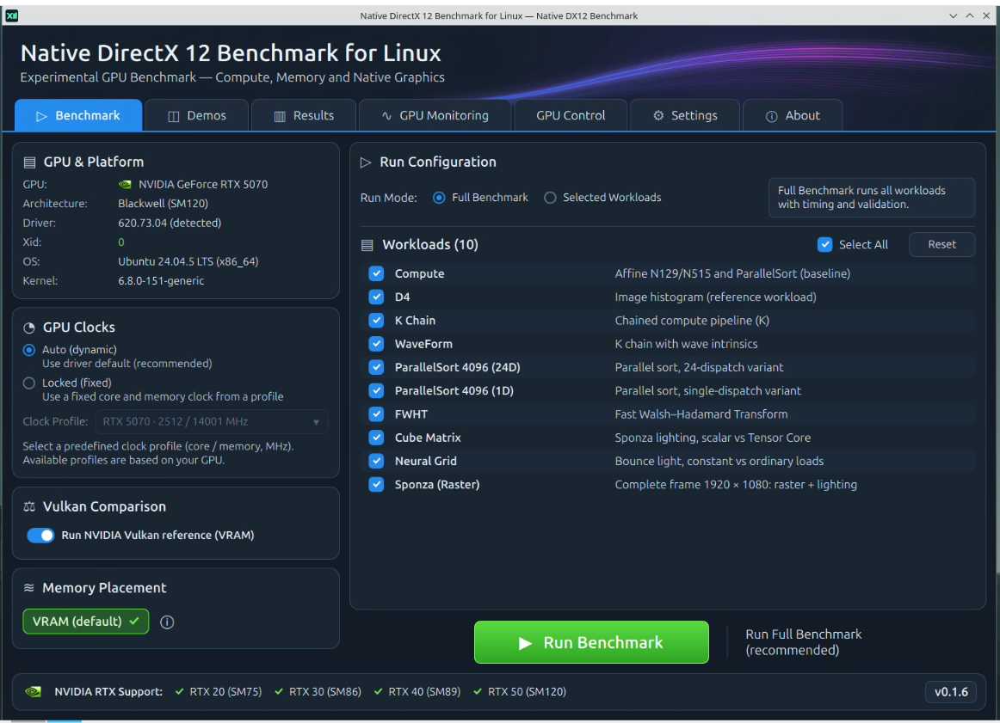
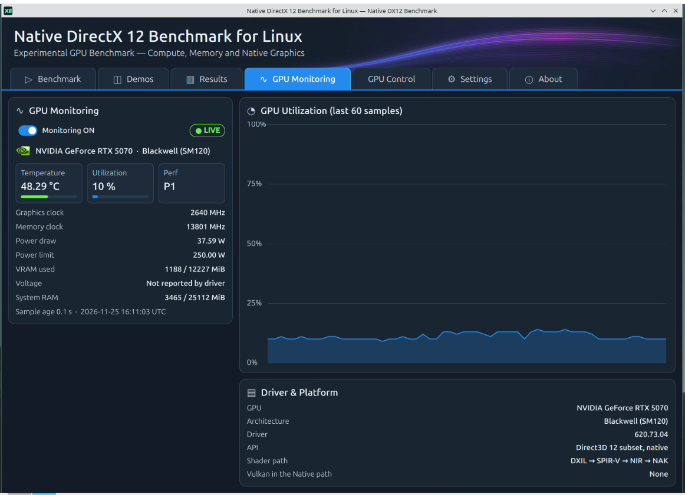
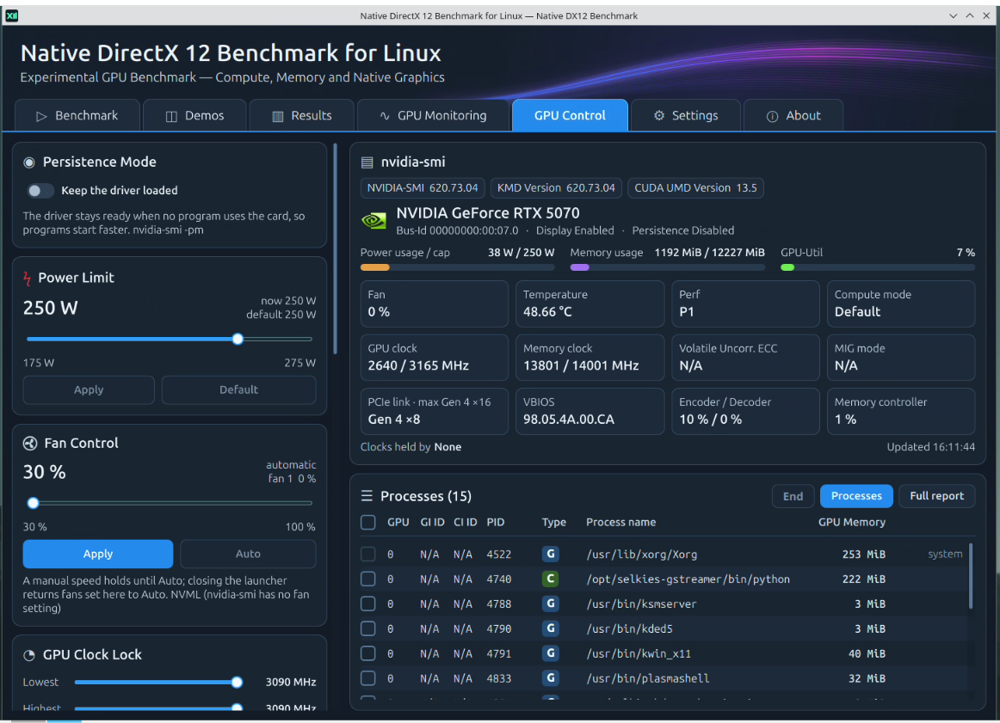
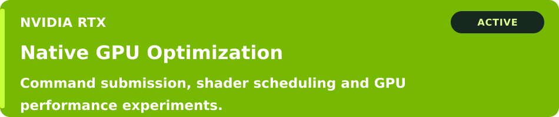
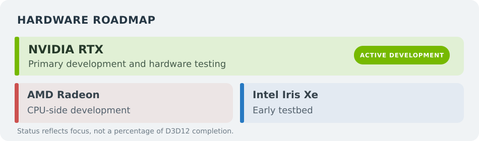

# Native DX12 Linux

**Native-DX12-Linux is an experimental Direct3D 12 runtime for Linux that executes directly on the GPU — completely bypassing Vulkan and VKD3D translation layers. Built around a direct shader pipeline (DXIL → NIR → NAK) and low-level NVIDIA RTX compute execution.**

**Help test and shape the next optimizations!**

**Release notice (25 November 2026):** Benchmark v0.1.6 downloads are temporarily paused while compatibility issues are addressed. Existing results, including partial runs and failures, remain welcome through the [benchmark results form](https://github.com/GoblinFlash/Native-DX12-Linux/issues/new?template=benchmark_results.yml).

**Andrew Kapica — GoblinFlash**

**AI-assisted development:** This project uses AI tools to assist with research, implementation, testing, code review, and documentation. AI-assisted contributions are subject to the same technical review, testing, and licensing requirements as other contributions. See the [contribution guidelines](AGENTS.md).

  
  
  

## Frequently Asked Questions (FAQ)

### How does Native-DX12-Linux differ from VKD3D-Proton and DXVK?

Compatibility tools on Linux implement Direct3D APIs using Vulkan:

* **DXVK** translates Direct3D 8/9/10/11 → Vulkan.
* **VKD3D-Proton** translates Direct3D 12 → Vulkan.

Both are mature, game-oriented projects. A translation layer introduces an API boundary, but its actual performance cost depends on the workload, implementation, and driver. It cannot be assumed from the architecture alone.

**Native-DX12-Linux does not use Vulkan or VKD3D in its experimental NVIDIA compute path.** Shaders are compiled through **DXIL → NIR → NAK**, and compute work is submitted through native NVIDIA Linux driver interfaces. The project is an experimental, compute-focused subset of Direct3D 12, **not** a drop-in replacement for commercial games or a complete D3D12 implementation.

## Native DirectX 12 Benchmark for Linux — v0.1.6 (downloads paused)

A major update featuring an improved native GPU execution path, expanded benchmark workloads, interactive native graphics demos and a redesigned desktop application.

- **Benchmark:** Generic Global NIR optimizations, VRAM placement for Native DX12 and Vulkan reference buffers, and new ParallelSort 4096 variants.
- **Demos:** Earth 4K, nBody 128, nBody 10K and nBody 4K.
- **GPU Monitoring:** Live GPU telemetry, utilization history, temperatures, clocks and memory usage.
- **GPU Control:** Selected `nvidia-smi` functionality and additional GPU management features, including power limits, fan control, clock locking and Persistence Mode.
- **Installation:** Temporarily unavailable while compatibility updates are tested. The single-file desktop installer will return with the next verified release.

**Downloads are paused.** Please use the [Releases](https://github.com/GoblinFlash/Native-DX12-Linux/releases) page to check which versions are currently available.

GPU management options depend on the hardware and driver. Included RTX profiles do not imply full hardware qualification.

### Benchmark

### GPU Monitoring

### GPU Control

## Current Progress

<picture>
  <source media="(max-width: 650px)" srcset=".github/readme-assets/progress-mobile.svg">
  
</picture>

## Current Work

**DEVELOPMENT ACTIVE**

<picture>
  <source media="(max-width: 650px)" srcset=".github/readme-assets/nvidia-mobile.svg">
  
</picture>

<picture>
  <source media="(max-width: 650px)" srcset=".github/readme-assets/goal-mobile.svg">
  
</picture>

<picture>
  <source media="(max-width: 650px)" srcset=".github/readme-assets/benchmark-mobile.svg">
  
</picture>

<picture>
  <source media="(max-width: 650px)" srcset=".github/readme-assets/frontend-mobile.svg">
  
</picture>

## Hardware Roadmap

<picture>
  <source media="(max-width: 650px)" srcset=".github/readme-assets/roadmap-mobile.svg">
  
</picture>

This roadmap shows **development focus**, not a percentage of Direct3D 12 completion. No delivery dates or full application compatibility are implied.

## Explore the Project

- [Benchmark details and supported hardware](NDX12_GPU_Benchmark/README.md) — workloads, requirements and hardware-specific validation records.
- [Submit benchmark results](https://github.com/GoblinFlash/Native-DX12-Linux/issues/new?template=benchmark_results.yml) — community submissions, including partial or failed runs.
- [Benchmark Results](Benchmark%20Results/README.md) — technical measurements, comparisons and recorded outcomes.
- [Build the source](container/README.md) — CPU-side build instructions; a successful build is not a GPU test.
- [Native pipeline overview](docs/native_dx12_linux_pipeline.svg) — experimental NVIDIA execution path.
- [NVIDIA Developer Forums discussion](https://forums.developer.nvidia.com/t/native-directx-12-on-linux/386938) — public progress and feedback.

The documented build environment is Ubuntu 26.04 x86-64. Hardware results belong to their recorded package revisions. **Included GPU profiles do not imply qualification of every listed card.**

## License and Credits

Created by **Andrew Kapica — GoblinFlash**. Project-owned material is licensed under **GPL-3.0-or-later**. Third-party components retain their original licenses; see [LICENSE](LICENSE) and [NOTICE](NOTICE).

### Community Contributors

- [Hyrules](https://github.com/Hyrules) — Benchmark testing, bug reports and valuable feedback.

Experimental project · Native compute subset only · Status updated 25 November 2026
