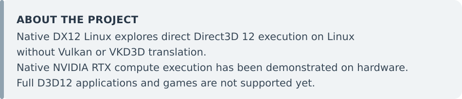
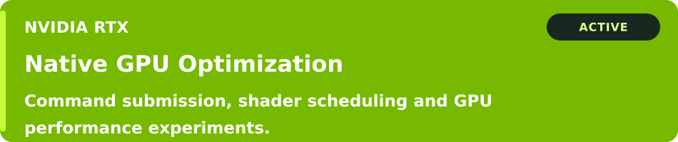
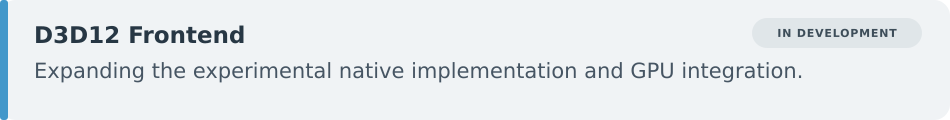
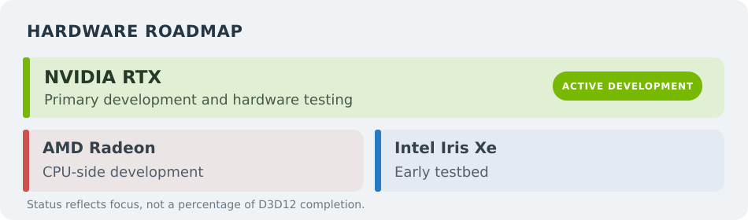

# Native DX12 Linux

**Experimental native Direct3D 12 on Linux — without Vulkan or VKD3D translation.**

Andrew Kapica — GoblinFlash

  
  
  

<picture>
  <source media="(max-width: 650px)" srcset=".github/readme-assets/about-mobile.svg">
  
</picture>

## Current Progress

<picture>
  <source media="(max-width: 650px)" srcset=".github/readme-assets/progress-mobile.svg">
  
</picture>

## Current Work

**DEVELOPMENT ACTIVE**

<picture>
  <source media="(max-width: 650px)" srcset=".github/readme-assets/nvidia-mobile.svg">
  
</picture>

<picture>
  <source media="(max-width: 650px)" srcset=".github/readme-assets/goal-mobile.svg">
  
</picture>

<picture>
  <source media="(max-width: 650px)" srcset=".github/readme-assets/benchmark-mobile.svg">
  
</picture>

<picture>
  <source media="(max-width: 650px)" srcset=".github/readme-assets/frontend-mobile.svg">
  
</picture>

## Hardware Roadmap

<picture>
  <source media="(max-width: 650px)" srcset=".github/readme-assets/roadmap-mobile.svg">
  
</picture>

This roadmap shows **development focus**, not a percentage of Direct3D 12 completion. No delivery dates or full application compatibility are implied.

## Explore the Project

- [Benchmark details and supported hardware](NDX12_GPU_Benchmark/README.md) — workloads, requirements and hardware-specific validation records.
- [Submit benchmark results](https://github.com/GoblinFlash/Native-DX12-Linux/issues/new?template=benchmark_results.yml) — community submissions, including partial or failed runs.
- [Experiment Results](Experiment%20Results/README.md) — technical measurements, comparisons and recorded outcomes.
- [Build the source](container/README.md) — CPU-side build instructions; a successful build is not a GPU test.
- [Native pipeline overview](docs/native_dx12_linux_pipeline.svg) — experimental NVIDIA execution path.
- [NVIDIA Developer Forums discussion](https://forums.developer.nvidia.com/t/native-directx-12-on-linux/386938) — public progress and feedback.

The documented build environment is Ubuntu 26.04 x86-64. Hardware results belong to their recorded package revisions. **The v0.1.5 release has CPU-side validation; it is not a new GPU qualification of every listed card.**

## License and Credits

Created by **Andrew Kapica — GoblinFlash**. Project-owned material is licensed under **GPL-3.0-or-later**. Third-party components retain their original licenses; see [LICENSE](LICENSE) and [NOTICE](NOTICE).

### Community Contributors

- [Hyrules](https://github.com/Hyrules) — Benchmark testing, bug reports and valuable feedback.

Experimental project · Native compute subset only · Status updated 11 November 2026
