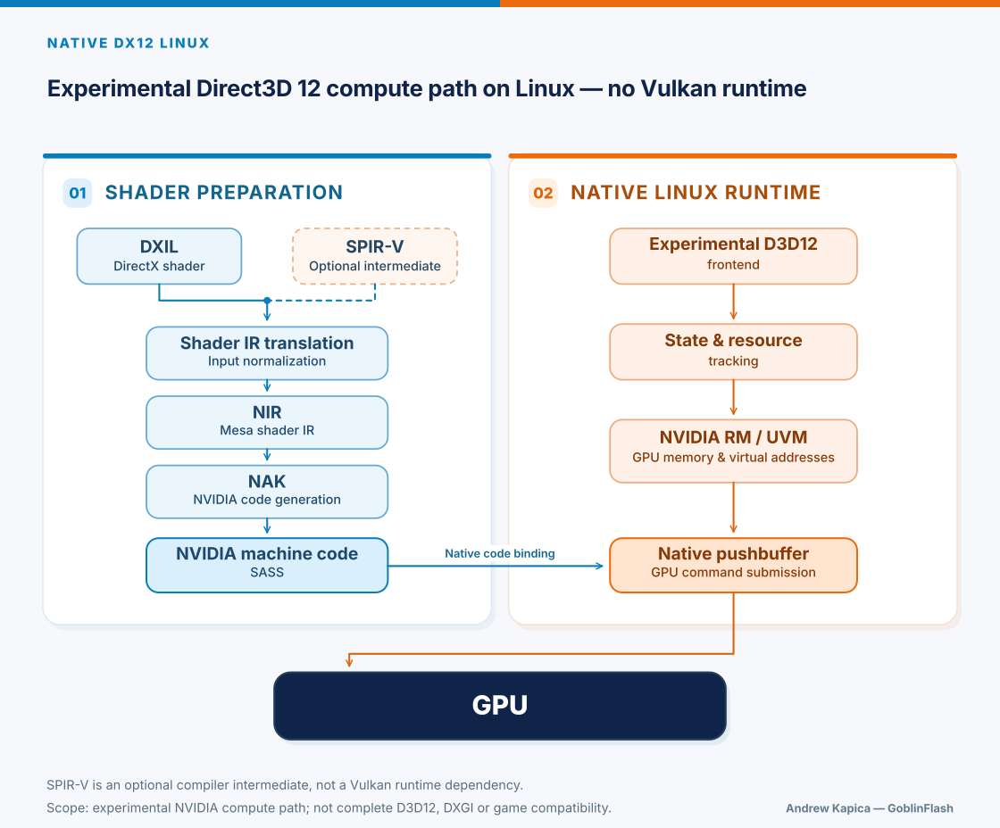

# Native DX12 Linux

Created by Andrew Kapica — GoblinFlash.

Working to bring native DirectX 12 support to Linux — without Vulkan translation.

This is an experimental project. The documented build platform is Ubuntu 26.04 (x86-64).
The source tree includes NVIDIA, AMD, and Intel components.

Full Direct3D 12 support is not yet available, including complete Shader Model and feature-level coverage, Windows ABI, DXGI, and game compatibility.

## Community & Discussion

Follow the project's progress and technical discussions:

[NVIDIA Developer Forums — Native DirectX 12 on Linux](https://forums.developer.nvidia.com/t/native-directx-12-on-linux/386938)

## Architecture



## Components and evidence boundaries

| Component | Source path and implementation | Evidence for this package |
| --- | --- | --- |
| NVIDIA | Shared RM/UVM compute runtime for affine and FidelityFX ParallelSort. Affine uses DXIL/LLVMBC -> NIR -> NAK; ParallelSort uses DXIL -> SPIR-V -> NIR -> NAK. | The two recorded RTX 4090 cases below. These do not qualify the experimental D3D12 frontend API. |
| Intel | C++ frontend and Gallium/Iris backend, with compute and offscreen graphics examples. DXIL -> SPIR-V -> NIR. | CPU/build evidence applies to the source versions named in its receipts. No Intel GPU qualification is claimed for this export. |
| AMD | CORE/RadeonSI adapter, compiler dependencies and CPU contract tests. | Recorded CPU adapter checks: 56 controls and four output images. Full AMD frontend/device execution is not qualified; no AMD GPU claim. |

The NVIDIA submission code uses RM/UVM. SPIR-V is a compiler intermediate for
ParallelSort, not a claim that the workload uses a Vulkan runtime. This README
does not extend historical path/library checks to every rebuilt output.

## Recorded RTX 4090 cases

The recorded host used GeForce RTX 4090, PCI 10de:2684, Ada SM89, NVIDIA UNIX
Open Kernel Module 615.78.08, Ubuntu 26.04.1, kernel 7.0.0-42-generic, x86-64.

| Case | Recorded execution | Checked result |
| --- | --- | --- |
| Affine u32 | N=129; one dispatch; grid 2x1x1, local size 128x1x1 | Independent u32 arithmetic, complete input/output/guard buffers and padding |
| FidelityFX ParallelSort | N=515, max_groups=1; prefix40, 40 dispatches | Independent final sorting/permutation check and complete final images; no per-dispatch image qualification |

Both recorded attempts reached CLOSED with zero remaining owners, completion
signal 101 and GET=PUT=1. One FIFO entry contains the 40-dispatch sort workload;
GET/PUT is not the dispatch count. The control-image check compared 1,048,072
bytes, excluding exactly 504 bytes of RM USERD. There were no new kernel records
inside either execution window. Sixteen AppArmor "who" records outside those
windows were reported separately.

Evidence identity for these recorded cases:

- Source lock: 2174d8755fe39a40c80cca58ab01044c4ae7efdff8a1e60e455b06cd4da201ad.
- Affine shader binary: ffbc8fd32b70a4485c34a2fa9d5ee85c01af3539a645b1cffa3525a1b3c448ae.
- Affine output image: e2dd76c76f477af81812707b2ac0c661a23189677f2ef6170e17205f76ddf38a.
- Recorded summary SHA-256: 537f45f75bc7e0a433496d87174c084fc34f10a30cb9f69bae49649f95ba50e4.

These identities name the recorded version, not a later documentation revision.
The raw development evidence is retained privately and is not part of the source
distribution. This summary describes recorded observations; it is not a
publicly replayable GPU evidence bundle. No benchmark, long-term stability,
other GPU/driver, arbitrary shader or general D3D12 Dispatch is qualified.
The runtime's formal native_execution_proven flags remain false; the experimental
observations above are reported separately.

## CPU build

The entrypoint is build.py. See [dependencies](deps/README.md) and
[the build container](container/README.md) for prerequisites, pinned source
acquisition and output ownership. The tools do not install system packages.
Build outputs, dependency caches and source directories must be separate.

Run these commands from the source root, after explicitly installing prerequisites.
The first command accesses the network and writes a dependency cache. The second
uses a fresh output directory and runs CPU compilation/admission checks only:

```sh
python3 -I -B deps/prepare_deps.py fetch --cache /absolute/ndx12-cache
python3 -I -B build.py --build-root /absolute/fresh-ndx12-build \
  --cache /absolute/ndx12-cache --jobs 2 --offline --targets intel,rtx,amd
```

The cache must be outside the source and build roots. The build root must be fresh.
Jobs are limited to four; two are the example setting. --offline uses a network
namespace and refuses missing inputs. For OCI execution the launcher provides
--network=none and does not request nested unshare; retain its launch receipt.
A successful build writes project/build-results.json, but does not launch GPU work.

An earlier real Podman build compiled all three selected CPU targets from a
verified local dependency cache. That receipt predates six runtime-input/template
changes: 172 of 178 input files match the later runtime input set. The later
production runtime stage passed CPU verification using existing pinned compiler
outputs; it did not repeat the full dependency/compiler build.

In a later validation on 2026-11-03, one public-endpoint fetch into a fresh
cache exited 0, followed by complete offline manifest verification: 13/13
entries passed. The same cache was reused and verified again for the build
below, without another fetch.

The immediate source predecessor of this documentation-only revision then
passed one clean all-target CPU build in an existing immutable Podman toolchain
image: `--targets intel,rtx,amd`, `--jobs 2`, outer `--network=none`, no devices,
exit 0 in 516 seconds. All 18 dependency commands exited 0. Of 37 project
commands, 35 exited 0 and two expected refusals exited 1 with
`RTX_REJECT:DIRECT_PROFILE`. Installed runtime verification passed normally
and with `-O`: 177 files, 81 runtime pins, 61 packet pins and 43 modules.
AMD retains `full_frontend_link=false`; GPU execution was `NOT_RUN`.

This documentation-only revision and its updated source lock succeed those
built bytes; no new clean build of this revision was run. Code, dependencies
and runtime templates are unchanged here. The result does not provision a
clean host or transfer the recorded GPU qualification to rebuilt artifacts.
Bit-identical complete outputs across hosts or build roots are not promised.

## CPU regression checks

Tests require an explicit existing output directory outside the source root.
They create retained per-run subdirectories. Execute normal and optimized Python:

```sh
NDX12_TEST_ROOT=/absolute/ndx12-test-output python3 -I -B tests/test_build.py
NDX12_TEST_ROOT=/absolute/ndx12-test-output python3 -I -B -O tests/test_build.py
NDX12_TEST_ROOT=/absolute/ndx12-test-output python3 -I -B tests/test_runtime_guard.py
NDX12_TEST_ROOT=/absolute/ndx12-test-output python3 -I -B -O tests/test_runtime_guard.py
```

After a completed build, relocation/profile tests consume its runtime-inputs:

```sh
NDX12_TEST_ROOT=/absolute/ndx12-test-output NDX12_RUNTIME_INPUTS=/absolute/fresh-ndx12-build/project/runtime-inputs python3 -I -B tests/test_runtime_release.py
NDX12_TEST_ROOT=/absolute/ndx12-test-output NDX12_RUNTIME_INPUTS=/absolute/fresh-ndx12-build/project/runtime-inputs python3 -I -B -O tests/test_runtime_release.py
```

Recorded tests on the pinned source ran 20 build-test methods, 14 runtime-release
methods and one guard method containing 27 source-defined subcases per Python
mode. A subcase count is distinct from unittest method count. Runtime admission
checked 177 installed files, 81 runtime pins, 61 packet pins and 43 loaded modules.
Device access and native libraries were blocked in those admission checks;
CARD_INFO profile checks were mocked. These are CPU results, not device execution.

The loader retains logical @PACKAGE@/, @HEADERS@/ and @ARTIFACTS@/ locators.
It checks traversal/symlink boundaries and reads metadata/content from the same
opened descriptor. /proc/self/fd is required. This is a trusted-interpreter
integrity boundary, not an OS sandbox for arbitrary native code or existing FDs.

## GPU use and current limits

There is currently no documented public plan generator or end-to-end NVIDIA
example runner in this source export. native_bootstrap.py consumes an explicitly
pinned host/workload plan; a copied development plan is not a portable example.
The recorded cases above therefore do not constitute a public one-command demo.
The build container exposes no GPU devices and never enables execution.

No public runtime split or Intel/AMD removal is implied. Affine and ParallelSort
share admission and dependencies. CPU preparation, a saved receipt, code review
and fresh hardware execution are separate evidence levels.

## Licensing

Andrew Kapica's project-owned portions: Copyright (C) 2026 Andrew Kapica,
GPL-3.0-or-later; see LICENSE. Third-party originals, adaptations and declaration
material retain their applicable original terms and notices; see NOTICE and
component licence files. This is not a blanket GPL relicensing of dependencies
or a clean-room claim.

The source distribution excludes dependency trees, build outputs, toolchain/OCI
images, credentials, private sessions and raw development evidence.
