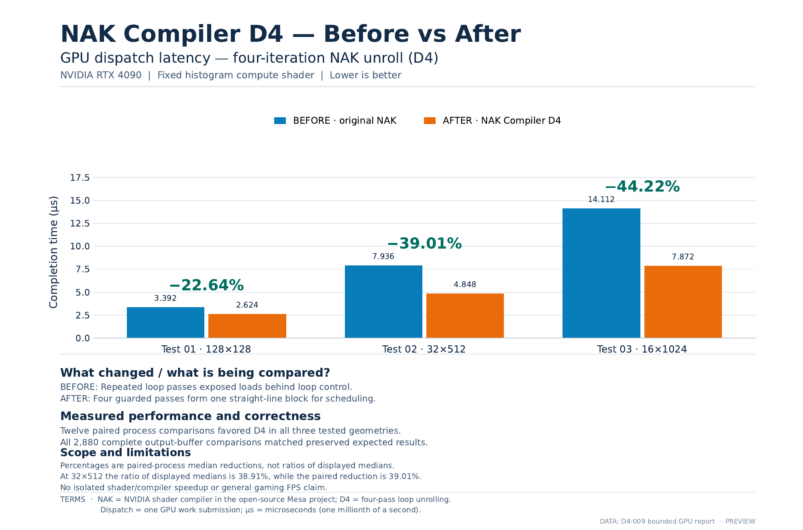
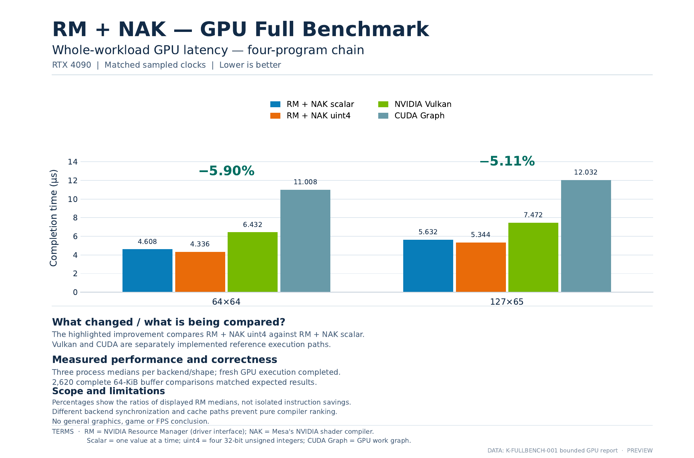

# Native DX12 Linux

**Direct3D 12 on Linux — without Vulkan or VKD3D translation.**

**Created by Andrew Kapica — GoblinFlash**

Native DX12 Linux is an open-source project that aims to run Direct3D 12 natively
on Linux. So far it includes an experimental D3D12 frontend, a shader compiler for
NVIDIA GPUs, and a separate test path that has already run compute work directly
on an RTX 4090.

It cannot run games or full Direct3D 12 applications yet.

NVIDIA comes first, followed by AMD and Intel. Early development was tested on
Intel Iris Xe.

## What works so far?

- **Native GPU execution on Linux**, without going through Vulkan.
- **Successful RTX 4090 tests**, with results checked for correctness.
- **Measured performance improvements** in GPU calculations.

## RTX 4090 — measured improvements

### Test 1: Faster histogram calculations

**What does it do?** The GPU counts how often different values appear in a set of data. This is called a **histogram** — the same kind of calculation used to analyse brightness and contrast in images.

The test uses **16,384 generated values from 0 to 255**, similar to grayscale pixel brightness. The **128×128, 32×512 and 16×1024** labels show different arrangements of that same amount of data.

**What improved?** Four repeated operations were grouped together. The GPU completed the same task in **up to 44.22% less time**, with the same checked result.

**Why is it important?** Faster histograms mean less time spent on this part of image processing.

### Test 2: Faster data processing across four GPU programs

**What does it do?** The GPU runs four connected programs: one prepares the data, two build counts of the values, and the last combines those counts. This is similar to image-processing tasks where the result of one step is used by the next.

The **64×64** and **127×65** labels on the chart refer to the dimensions of the generated test data.

**What improved?** The last program now reads four histogram values together instead of one by one. The **whole four-program task finished about 5–6% faster**, with the same checked result.

**Why is it important?** The improvement made the **complete sequence faster**, not just one isolated operation.

Vulkan and CUDA appear as separate reference measurements, not a like-for-like ranking.

[Measurement details](docs/validation.md)

## Current project status

| Area | Status |
| --- | --- |
| NVIDIA RTX 4090 | GPU tests completed with checked results. Public GPU testing tools are in development. |
| AMD Radeon | CPU-side development and checks underway; GPU testing is a next step. |
| Intel Iris Xe | Used for early development and testing; further work is planned. |

## GPU Benchmarking

Work is underway to make GPU benchmarks easier to run on your own Linux machine.

**Current test hardware: NVIDIA RTX 4090.** Support for the NVIDIA RTX 30 series is coming soon.

## Explore the project

- **[Build the source](container/README.md)** — instructions for compiling on the CPU; no GPU test is launched.
- **[How it works](docs/native_dx12_linux_pipeline.svg)** — an overview of the experimental NVIDIA path.
- **[NVIDIA Developer Forums discussion](https://forums.developer.nvidia.com/t/native-directx-12-on-linux/386938)** — progress and community feedback.

The documented build environment is Ubuntu 26.04 x86-64.

## License and credits

Created by **Andrew Kapica — GoblinFlash**. Project-owned material is licensed under **GPL-3.0-or-later**. Third-party components retain their original licenses; see [LICENSE](LICENSE) and [NOTICE](NOTICE).
